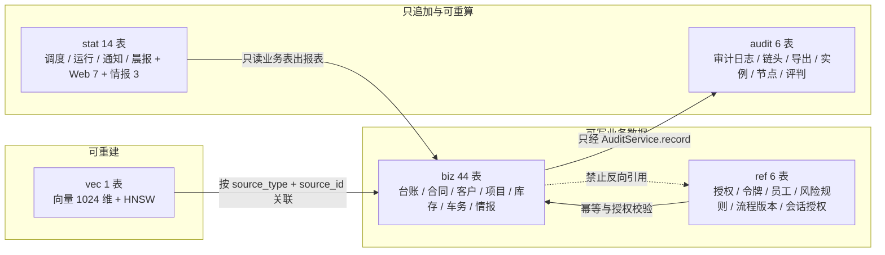
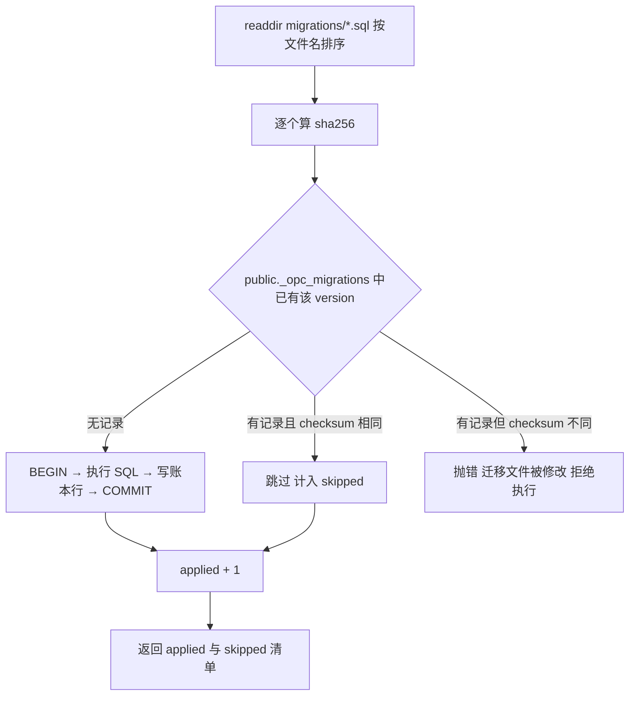

# OPC-玄机 · 一人公司中枢 数据库设计说明（OPC-DBDD-001）

本文档解决“共享数据层究竟建成什么样、为什么这样建、改动时哪条线不能碰”的问题：把 `biz/ref/audit/stat/vec` 五个语义 schema 的职责边界、76 张表的列与约束、关键索引（审计复合主键、向量 HNSW、令牌唯一、幂等唯一）、迁移链与不可变约束、备份与 30 年审计归档一次讲清。DBA 在预装扩展、建库与迁移时用第 5 章；后端在改表、加索引、写迁移前用第 3、4、7 章；审计与合规在取证、归档、保留期判定时用第 6 章。文中所有数字取自 `migrations/` 下的真实 DDL 与本地/私有部署的 `opc_test` 库基线实测（37 表 / 272 列 / 58 索引 / 75 个约束对象）+ v2.10 Web 层 8 表 + v2.11 员工线 9 表 + v2.12 项目研发 12 表 + v2.13 情报日报 10 表，不取自设想。

## 目录

- [1. 文档定位与数据口径](#1-文档定位与数据口径)
- [2. schema 分层与边界](#2-schema-分层与边界)
- [3. 表结构（76 张）](#3-表结构76-张)
- [4. 关键索引设计](#4-关键索引设计)
- [5. 扩展、迁移链与不可变约束](#5-扩展迁移链与不可变约束)
- [6. 备份、审计归档与保留期](#6-备份审计归档与保留期)
- [7. 一致性对账与偏差登记](#7-一致性对账与偏差登记)
- [8. 自检清单](#8-自检清单)
- [9. 与其他文档的关系](#9-与其他文档的关系)

## 1. 文档定位与数据口径

### 1.1 目的、读者与使用时机

本文件是 OPC-玄机数据层的**唯一结构事实源说明**：结构真值在 `migrations/*.sql`，本文把每张表的列、类型、约束、索引用可读形式固化，并对“为什么是这个类型”给出理由。评审时看本文，改表时看 `migrations/` 并同步本文。

| 角色 | 使用时机 | 重点章节 |
| :--- | :--- | :--- |
| DBA | 建库、装扩展、跑迁移、做备份与恢复演练 | 5、6 |
| 后端开发 | 新增表/列/索引、写迁移、排查约束冲突 | 3、4、5 |
| 架构评审 | 判定分层是否越界、跨 schema 引用是否合规 | 2、7 |
| 审计与合规 | 取证导出、保留期判定、归档链校验 | 4、6 |
| 测试 | 造种子数据、写集成测试清库清单 | 3、5 |

### 1.2 数据字典口径

口径由 `migrations/0001_init.sql` 头部约定统一规定，全库无例外（37 张基线 + 8 张 Web 表 + 9 张员工线表 + 12 张项目研发表全部符合）。

| 口径 | 规则 | 库内例证 |
| :--- | :--- | :--- |
| 主键 | `bigint GENERATED ALWAYS AS IDENTITY`，76 张表全部如此；复合主键仅审计表 | `biz.ledger.id`、`audit.audit_log (id, created_at)` |
| 对外标识 | 不用自增主键对外暴露；用 uuid 或 16 字节随机 hex | `audit.workflow_instance.instance_uuid`（`DEFAULT gen_random_uuid()`）、`ref.token.token_code`（应用侧 `randomBytes(16).toString("hex")`） |
| 金额 | `numeric(18,2)`；单价单独放宽到 4 位小数；里程 2 位；评分 2 位；置信度 2 位 | `biz.ledger.amount`、`biz.stock_txn.unit_price numeric(18,4)`、`biz.vehicle_log.km numeric(10,2)`、`audit.verifier_verdict.confidence numeric(3,2)` |
| 时间 | 时间点一律 `timestamptz`；只有“日历日”语义用 `date` | `created_at/started_at/expires_at` 为 timestamptz；`entry_date/trip_date/due/deadline/report_date/decided_on/quoted_on/published_at` 为 date |
| JSON 载荷 | 结构不稳定的复合字段用 `jsonb`，不拆宽表 | `conflict_queue.parties`、`workflow_registry.meta`、`task_schedule.config` |
| 枚举 | 用 `varchar` + `CHECK` 收敛，不建 Postgres enum 类型（避免加值要改类型） | 18 个 CHECK 约束，如 `ledger.direction IN ('in','out')` |
| 布尔 | 语义为“标记”的列 `NOT NULL DEFAULT false`，语义为“开关”的列 `DEFAULT true` | `conflict_frozen` 默认 false；`employee_plugin.enabled` 默认 true |
| 外键 | 仅在**同 schema 内**建 FK；跨 schema 与“多态冻结单元”只存 id 不建 FK | 7 个 FK 全在 schema 内部；`conflict_queue.frozen_unit_id` 是多态引用，故意无 FK |

### 1.3 对账方式（可复制）

本文与真实库的对账靠三条命令，任何一条对不上就说明文档或库有一方漂了：

```bash
cd /path/to/opc-xuanji
set -a; . ./.env; set +a      # 把 .env 载入当前 shell；下文 psql 用 $OPC_PG_DSN 与 $OPC_TEST_DSN

# 1) 迁移链是否已全部应用（应输出 0001–0007 七条）
node scripts/migrate.ts --test

# 2) 表数（应输出 biz 44 / ref 11 / audit 6 / stat 14 / vec 1，合计 76）
psql "$OPC_PG_DSN" -c \
  "select table_schema, count(*) from information_schema.tables
   where table_schema in ('biz','ref','audit','stat','vec') group by 1 order by 1;"

# 3) 列数与索引数（应输出 272 列、58 个索引）
psql "$OPC_PG_DSN" -c \
  "select (select count(*) from information_schema.columns where table_schema in ('biz','ref','audit','stat','vec')) as cols,
          (select count(*) from pg_indexes where schemaname in ('biz','ref','audit','stat','vec')) as idx;"
```

## 2. schema 分层与边界

### 2.1 五层职责与禁止项

分层不是命名习惯，而是权限与生命周期的分界：审计层只追加、统计层可重算、向量层可重建，业务层与码表层才是可写业务数据。

| schema | 放什么 | 禁止放什么 | 实测表数 | 代表表 |
| :--- | :--- | :--- | :--- | :--- |
| `biz` | 有生命周期的业务实体（台账、合同、客户、项目、库存、车务、WBS、外宣、情报） | 码表、统计宽表、审计流水 | 44 | `biz.ledger`、`biz.contract`、`biz.conflict_queue` |
| `ref` | 码表与注册表（授权、令牌、员工插件、风险规则、流程版本、会话授权、员工包） | 高频业务流水 | 8 | `ref.view_grant`、`ref.workflow_registry` |
| `audit` | 只追加的审计与流程实例痕迹 | 任何需要 UPDATE 的业务状态 | 6 | `audit.audit_log`、`audit.workflow_instance` |
| `stat` | 调度配置、运行记录、通知、晨报、Web 归置/记忆/驾驶舱/雷达、情报运行记录（可重算可覆盖） | 被业务表外键引用的主数据 | 14 | `stat.task_schedule`、`stat.daily_report` |
| `vec` | 向量列与知识分块 | 与业务事务强耦合的大字段 | 1 | `vec.embedding vector(1024)` |

边界的两条硬规则：

1. **审计层不可变**：`audit.audit_log` 只有 INSERT 与 SELECT 路径（`AuditService.record` 追加、`verifyChain` 只读），代码中不存在对其 UPDATE/DELETE 的语句；流程节点与实例的状态变更走 `audit.workflow_instance.status`（生命周期表），不回改历史审计行。
2. **敏感字段独立存储**：`biz.customer_sensitive` 是客户管家私有存储，`ref`/`biz` 的其它表与其只有 `customer_id` 关系；共享视图 `view_customer_base` 不 JOIN 该表，跨域读取只经一次性令牌（`ref.token`）。



### 2.2 跨 schema 外键政策

全库 7 个外键**全部落在同一 schema 内**，跨 schema 一律只存 id：这既是分层要求，也让分层备份/恢复可以按 schema 独立演练。

| 外键 | 归属 | 级联 |
| :--- | :--- | :--- |
| `customer_sensitive.customer_id` → `customer.id` | biz 内 | ON DELETE CASCADE |
| `commitment.customer_id` → `customer.id` | biz 内 | ON DELETE CASCADE |
| `quote.customer_id` → `customer.id` | biz 内 | ON DELETE CASCADE |
| `stock_txn.sku_id` → `sku.id` | biz 内 | 默认 NO ACTION |
| `stock_txn.reversal_of` → `stock_txn.id` | biz 内（自引用，冲正链） | 默认 NO ACTION |
| `workflow_node_run.instance_id` → `workflow_instance.id` | audit 内 | ON DELETE CASCADE |
| `verifier_verdict.instance_id` → `workflow_instance.id` | audit 内 | ON DELETE CASCADE |

跨 schema 的引用只存 id、不建 FK 的三处代表：`audit.audit_log.workflow_instance_id`（审计在实例删除后仍需可读）、`biz.conflict_queue.frozen_unit_id`（多态冻结单元：ledger/contract/stock_txn/vehicle_log 四选一）、`biz.ledger.project_id`（业务弱引用，避免跨域锁）。

### 2.3 76 张表清单总览

基线列数合计 272（37 表）；v2.10 Web 层新增 8 表另计。下表是第 3 章的索引页：先看清单定位，再进 3.x 看列级定义。

| # | 表 | 中文名 | 列数 | 关键约束/索引 |
| :--- | :--- | :--- | :--- | :--- |
| 1 | `biz.company_profile` | 公司档案 | 7 | 主键 |
| 2 | `biz.conflict_queue` | 冲突冻结队列 | 9 | `conflict_type/status` CHECK；`arbitration_id` 指向裁决 |
| 3 | `biz.ledger` | 资金台账 | 10 | `direction/entity` CHECK；`ledger_frozen_idx` 部分索引 |
| 4 | `biz.tax_calendar` | 申报日历 | 6 | 唯一 `(tax_type, period)` |
| 5 | `biz.ar_ap` | 应收应付 | 7 | 主键 |
| 6 | `biz.contract` | 合同台账 | 8 | `contract_end_idx` 部分索引 |
| 7 | `biz.event` | 日程事件 | 6 | 主键 |
| 8 | `biz.action_item` | 会议行动项 | 5 | 主键 |
| 9 | `biz.objective` | 目标与关键结果 | 4 | 主键 |
| 10 | `biz.decision` | 决策与裁决留痕 | 6 | 主键 |
| 11 | `biz.project` | 项目（含研发档案） | 16 | `progress BETWEEN 0 AND 100` |
| 12 | `biz.customer` | 客户基础信息 | 7 | 主键 |
| 13 | `biz.customer_sensitive` | 客户敏感字段（私有） | 5 | 唯一 `(customer_id, field)`；FK 级联 |
| 14 | `biz.commitment` | 客户承诺 | 6 | FK 级联 |
| 15 | `biz.quote` | 报价 | 6 | FK 级联 |
| 16 | `biz.sku` | SKU | 5 | 主键 |
| 17 | `biz.stock_txn` | 出入库流水 | 11 | `txn_type` CHECK；`reversal_of` 自引用 |
| 18 | `biz.vehicle_log` | 用车台账 | 9 | 主键 |
| 19 | `biz.subsidy_standard` | 补贴标准库 | 12 | 唯一 `(region, year, version)`；两个 CHECK |
| 20 | `biz.lead` | 线索 | 5 | 主键 |
| 21 | `biz.dd_report` | 尽调报告 | 6 | 主键 |
| 22 | `ref.view_grant` | 视图授权 | 6 | 唯一 `(view_id, plugin_id)`；`status` CHECK |
| 23 | `ref.token` | 一次性令牌 | 8 | `token_code_uidx` 唯一部分索引；`token_expiry_idx` |
| 24 | `ref.employee_plugin` | 员工插件注册 | 13 | `plugin_id` 唯一；`scope` CHECK；含 manifest/生命周期列 |
| 25 | `ref.risk_rule` | 风险规则库 | 7 | `rule_id` 唯一 |
| 26 | `ref.workflow_registry` | 流程版本注册表 | 10 | 唯一 `(workflow_id, version)`；三个 CHECK |
| 27 | `audit.audit_log` | 审计日志 | 13 | 复合主键 `(id, created_at)`；2 个二级索引 |
| 28 | `audit.audit_chain_head` | 审计链头 | 4 | 单行链头（`last_hash`/`last_export_id`） |
| 29 | `audit.audit_export` | 审计导出记录 | 7 | 归档链 `prev_export_hash`、游标 `last_audit_id` |
| 30 | `audit.workflow_instance` | 流程实例 | 8 | `instance_uuid` 唯一；`status` CHECK |
| 31 | `audit.workflow_node_run` | 节点执行 | 9 | 唯一 `(instance_id, node_id)` = 幂等键 |
| 32 | `audit.verifier_verdict` | 评判结论 | 9 | `verdict` CHECK；`verdict_evidence_idx` |
| 33 | `stat.task_schedule` | 调度配置 | 8 | `task_id` 唯一 |
| 34 | `stat.task_run` | 任务运行 | 9 | 唯一 `(task_id, scheduled_at)` = 幂等键；`status` CHECK |
| 35 | `stat.notification` | 通知队列 | 6 | `level` CHECK |
| 36 | `stat.daily_report` | 每日晨报 | 4 | `report_date` 唯一 |
| 37 | `vec.embedding` | 向量记忆 | 8 | 唯一 `(source_type, source_id, model_id)`；HNSW 索引 |
| 38 | `stat.web_ingest_item` | 归置收件箱 | 13 | 幂等键唯一；`status`/`domain` CHECK |
| 39 | `ref.web_session_grant` | 会话授权 | 8 | `session_id + status + expires_at` 索引 |
| 40 | `stat.web_session_message` | 会话片段 | 6 | 唯一 `(session_id, message_id)` |
| 41 | `stat.web_memory_card` | 记忆卡片 | 8 | 唯一 `(scope, content_hash)` |
| 42 | `stat.web_memory_proposal` | 记忆提议 | 8 | `status` CHECK |
| 43 | `stat.dashboard_snapshot` | 驾驶舱快照 | 6 | `range_key + generated_at` 索引 |
| 44 | `stat.brief_item` | 简报条目 | 8 | 唯一 `(brief_date, brief_type, title)` |
| 45 | `stat.radar_item` | 插件/关键词雷达 | 10 | 唯一 `(radar_type, dedupe_key)` |
| 46 | `biz.wbs_node` | WBS 工作包/任务 | 16 | 唯一 `(project_id, node_code)`；状态/进度 CHECK |
| 47 | `biz.wbs_baseline` | WBS 基线 | 6 | 唯一 `(project_id, version)` |
| 48 | `biz.wbs_change` | WBS 变更单 | 8 | `change_type/status` CHECK；FK `wbs_id` |
| 49 | `biz.publication_plan` | 外宣计划 | 5 | `status` CHECK |
| 50 | `biz.publication` | 外宣内容 | 12 | `status/risk_level` CHECK |
| 51 | `biz.publication_approval` | 外宣审批 | 5 | `decision` CHECK；FK 级联 |
| 52 | `biz.channel_account` | 渠道账号 | 6 | 唯一 `(channel, account_name)` |
| 53 | `ref.employee_package` | 员工包 | 11 | `package_code` 唯一 |
| 54 | `ref.employee_import_job` | 员工包导入任务 | 7 | `status` CHECK |
| 55 | `biz.project_milestone` | 项目里程碑/关键节点 | 10 | `status` CHECK；`(project_id,target_date)` 索引 |
| 56 | `biz.work_log` | 工时记录 | 8 | `hours` CHECK；`(project_id,work_date)` 索引 |
| 57 | `ref.code_repository` | Git/SVN 版本库 | 10 | `kind/sync_mode/sync_status` CHECK；唯一 `(project_id,name)` |
| 58 | `ref.artifact_repository` | Maven/Docker 制品库 | 9 | `kind/status` CHECK；唯一 `(project_id,name)` |
| 59 | `ref.deploy_environment` | SSH 部署环境 | 12 | `env_type/approval_policy` CHECK；唯一 `(project_id,name)` |
| 60 | `biz.release_order` | 发布单 | 13 | `status` CHECK；项目/环境索引 |
| 61 | `biz.test_plan` | 测试计划 | 12 | `status` CHECK；唯一 `(project_id,version)` |
| 62 | `biz.test_case` | 测试用例 | 13 | `priority/kind/status` CHECK；唯一 `(project_id,case_code)` |
| 63 | `biz.test_suite` | 测试套件 | 6 | `status` CHECK；唯一 `(project_id,name)` |
| 64 | `biz.test_run` | 测试执行批次 | 11 | `executor_type/status` CHECK；`(project_id,status)` 索引 |
| 65 | `biz.test_result` | 测试逐例结果 | 7 | `result` CHECK；唯一 `(run_id,case_id)` |
| 66 | `biz.defect` | 缺陷 | 11 | `severity/status` CHECK；`(project_id,status,severity)` 索引 |
| 67 | `biz.intel_project_scope` | 项目情报空间 | 14 | `UNIQUE(project_id)`；`brief_time` 正则 CHECK |
| 68 | `biz.source` | 采集数据源 | 19 | `source_type/copyright_status/status` CHECK；`index(status,enabled)` |
| 69 | `biz.source_binding` | 来源-项目绑定 | 6 | `UNIQUE(source_id,project_id)`；`index(project_id,enabled)` |
| 70 | `biz.watch_topic` | 项目关键词规则 | 11 | `match_type` CHECK；`UNIQUE(project_id,keyword)` |
| 71 | `biz.intel_tag` | 项目标签字典 | 8 | `status` CHECK；`UNIQUE(project_id,name)` |
| 72 | `biz.intel_item` | 情报条目 | 23 | `status/info_type/risk_level` CHECK；`UNIQUE(project_id,idempotency_key)` |
| 73 | `biz.intel_brief` | 情报日报 | 14 | `status/brief_type` CHECK；`UNIQUE(project_id,brief_date,brief_type,version)` |
| 74 | `stat.intel_collect_run` | 采集运行 | 16 | `status` CHECK；`idempotency_key` 唯一 |
| 75 | `stat.intel_pipeline_run` | 流水线运行 | 10 | `stage/status` CHECK；`idempotency_key` 唯一 |
| 76 | `stat.intel_push_log` | 推送记录 | 10 | `status` CHECK；`UNIQUE(brief_id,channel,target)` |

清单可直接对着库核一遍（基线 272 列 / 37 表；v2.10 Web 层另增 8 表，v2.11 员工线 9 表，v2.12 项目研发 12 表，v2.13 情报 10 表，明细见 3.6–3.9）：

```sql
-- 按 schema 统计表与列（v2.13 后：biz 44、ref 11、audit 6、stat 14、vec 1；列数随增量表变化）
SELECT table_schema AS schema,
       count(DISTINCT table_name) AS tables,
       count(*)                   AS columns
FROM information_schema.columns
WHERE table_schema IN ('biz','ref','audit','stat','vec')
GROUP BY table_schema ORDER BY table_schema;
```

## 3. 表结构（76 张）

本章按 schema 分节。每张表给出列级定义（列名 / 类型 / 可空 / 默认 / 说明）与索引约束，字段口径见 1.2。所有表主键均为 `id bigint GENERATED ALWAYS AS IDENTITY`，为避免重复，下文不再逐行标注主键列，只在“索引与约束”里写明主键名。

### 3.1 biz 层（21 张，业务实体）

#### 3.1.1 biz.company_profile（公司档案）

| 列 | 类型 | 空 | 默认 | 说明 |
| :--- | :--- | :--- | :--- | :--- |
| `id` | bigint | NOT NULL | identity | 主键 |
| `name` | varchar(128) | NOT NULL | — | 公司名称 |
| `entity_type` | varchar(32) | NOT NULL | — | 主体类型（服务型/贸易型/混合型） |
| `tax_types` | jsonb | NULL | — | 税种集合 |
| `bank_accounts` | jsonb | NULL | — | 银行账户集合 |
| `owner_preferences` | jsonb | NULL | — | 老板偏好画像（一人一助理的上下文来源） |
| `updated_at` | timestamptz | NOT NULL | `now()` | 档案版本时间 |

索引与约束：主键 `company_profile_pkey (id)`。档案只有一份，行数恒为 1，不加额外索引。

#### 3.1.2 biz.conflict_queue（冲突冻结队列）

| 列 | 类型 | 空 | 默认 | 说明 |
| :--- | :--- | :--- | :--- | :--- |
| `id` | bigint | NOT NULL | identity | 主键，即冲突号 |
| `conflict_type` | varchar(32) | NOT NULL | — | CHECK：`cost` / `customer` / `stock_batch` / `contract_amount` |
| `frozen_unit_type` | varchar(32) | NOT NULL | — | 冻结单元类型，代码侧只接受 `ledger` / `contract` / `stock_txn` / `vehicle_log` |
| `frozen_unit_id` | bigint | NOT NULL | — | 冻结单元主键（多态引用，故意不建外键） |
| `parties` | jsonb | NOT NULL | — | 双方原始依据，代码侧要求至少 2 条 |
| `diff_fields` | jsonb | NULL | — | 差异字段名数组 |
| `detected_at` | timestamptz | NOT NULL | `now()` | 发现时间，冲突超期提醒按它计时 |
| `status` | varchar(16) | NOT NULL | `'open'` | CHECK：`open` / `resolved` / `cleared` / `later` |
| `arbitration_id` | bigint | NULL | — | 裁决记录 id，指向 `biz.decision.id` |

索引与约束：主键 `conflict_queue_pkey (id)`；CHECK `conflict_type`、CHECK `status`。`arbitration_id` 不建外键，裁决记录删除也不影响冲突历史。

#### 3.1.3 biz.ledger（资金台账）

| 列 | 类型 | 空 | 默认 | 说明 |
| :--- | :--- | :--- | :--- | :--- |
| `id` | bigint | NOT NULL | identity | 主键 |
| `entry_date` | date | NOT NULL | — | 业务日期 |
| `amount` | numeric(18,2) | NOT NULL | — | 金额，正负由 `direction` 决定 |
| `direction` | varchar(8) | NOT NULL | — | CHECK：`in` / `out` |
| `category` | varchar(32) | NOT NULL | — | 成本/收入科目 |
| `entity` | varchar(16) | NOT NULL | — | CHECK：`company` / `personal`（公私边界） |
| `invoice_id` | varchar(64) | NULL | — | 发票号，缺票时为空 |
| `project_id` | bigint | NULL | — | 弱引用项目，不建外键 |
| `note` | text | NULL | — | 备注 |
| `conflict_frozen` | boolean | NOT NULL | `false` | 冻结标记，汇总查询据此出“含冻结总额 + 脚注” |

索引与约束：主键 `ledger_pkey (id)`；CHECK `direction`、CHECK `entity`；部分索引 `ledger_frozen_idx (conflict_frozen) WHERE conflict_frozen`——只索引被冻结的少数行，`ConflictService.summaryIncludingFrozen` 的过滤走这条索引。

#### 3.1.4 biz.tax_calendar（申报日历）

| 列 | 类型 | 空 | 默认 | 说明 |
| :--- | :--- | :--- | :--- | :--- |
| `id` | bigint | NOT NULL | identity | 主键 |
| `tax_type` | varchar(32) | NOT NULL | — | 税种 |
| `period` | varchar(16) | NOT NULL | — | 所属期 |
| `deadline` | date | NOT NULL | — | 截止日，晨报与税务预警按它筛 7 天窗口 |
| `status` | varchar(16) | NOT NULL | `'pending'` | 申报状态 |
| `source_version` | varchar(32) | NULL | — | 口径来源版本（可溯源原则） |

索引与约束：主键 `tax_calendar_pkey (id)`；唯一约束 `tax_calendar_tax_type_period_key (tax_type, period)`——同一税种同一所属期只能有一条，防止重复排期。

#### 3.1.5 biz.ar_ap（应收应付）

| 列 | 类型 | 空 | 默认 | 说明 |
| :--- | :--- | :--- | :--- | :--- |
| `id` | bigint | NOT NULL | identity | 主键 |
| `counterparty` | varchar(128) | NOT NULL | — | 相对方，视图按它聚合 |
| `amount` | numeric(18,2) | NOT NULL | — | 金额 |
| `due` | date | NULL | — | 到期日 |
| `status` | varchar(16) | NOT NULL | `'open'` | 状态 |
| `contract_id` | bigint | NULL | — | 弱引用合同 |
| `project_id` | bigint | NULL | — | 弱引用项目 |

索引与约束：主键 `ar_ap_pkey (id)`。聚合查询 `view_ar_ap` 按 `(counterparty, status)` 分组并取 `min(due)`，万级数据量下全表聚合可接受，未加索引。

#### 3.1.6 biz.contract（合同台账）

| 列 | 类型 | 空 | 默认 | 说明 |
| :--- | :--- | :--- | :--- | :--- |
| `id` | bigint | NOT NULL | identity | 主键 |
| `counterparty` | varchar(128) | NOT NULL | — | 相对方 |
| `amount` | numeric(18,2) | NULL | — | 合同金额，金额口径冲突时是冻结单元 |
| `start_date` | date | NULL | — | 起始日 |
| `end_date` | date | NULL | — | 到期日，到期提醒按 ≤30 天筛 |
| `status` | varchar(16) | NOT NULL | `'active'` | 状态 |
| `risk_flags` | jsonb | NULL | — | 风险扫描标记 |
| `conflict_frozen` | boolean | NOT NULL | `false` | 冻结标记 |

索引与约束：主键 `contract_pkey (id)`；部分索引 `contract_end_idx (end_date) WHERE status = 'active'`——只为在执行的合同建索引，到期扫描（`contract_expiry` 任务）直接命中。

#### 3.1.7 biz.event（日程事件）

| 列 | 类型 | 空 | 默认 | 说明 |
| :--- | :--- | :--- | :--- | :--- |
| `id` | bigint | NOT NULL | identity | 主键 |
| `start_at` | timestamptz | NOT NULL | — | 开始时间 |
| `participants` | jsonb | NULL | — | 参与人 |
| `related_customer` | bigint | NULL | — | 关联客户（弱引用） |
| `related_project` | bigint | NULL | — | 关联项目（弱引用） |
| `source` | varchar(16) | NULL | — | 来源（手动/IM/日历同步） |

索引与约束：主键 `event_pkey (id)`。

#### 3.1.8 biz.action_item（会议行动项）

| 列 | 类型 | 空 | 默认 | 说明 |
| :--- | :--- | :--- | :--- | :--- |
| `id` | bigint | NOT NULL | identity | 主键 |
| `meeting_id` | bigint | NULL | — | 所属会议 |
| `owner` | varchar(64) | NOT NULL | — | 责任人 |
| `due` | date | NULL | — | 期限 |
| `status` | varchar(16) | NOT NULL | `'open'` | 状态 |

索引与约束：主键 `action_item_pkey (id)`。

#### 3.1.9 biz.objective（目标与关键结果）

| 列 | 类型 | 空 | 默认 | 说明 |
| :--- | :--- | :--- | :--- | :--- |
| `id` | bigint | NOT NULL | identity | 主键 |
| `name` | varchar(128) | NOT NULL | — | 目标名 |
| `key_results` | jsonb | NULL | — | 关键结果数组 |
| `period` | varchar(16) | NULL | — | 周期，`view_okr` 的过滤字段 |

索引与约束：主键 `objective_pkey (id)`。

#### 3.1.10 biz.decision（决策与裁决留痕）

| 列 | 类型 | 空 | 默认 | 说明 |
| :--- | :--- | :--- | :--- | :--- |
| `id` | bigint | NOT NULL | identity | 主键 |
| `decided_on` | date | NOT NULL | — | 裁决日期 |
| `context` | text | NULL | — | 裁决上下文（冲突号 + 冻结单元摘要） |
| `choices` | jsonb | NULL | — | 双方依据快照 |
| `chosen` | text | NULL | — | 选择结果（`A` / `B` / `manual`） |
| `rationale` | text | NULL | — | 理由 |

索引与约束：主键 `decision_pkey (id)`。`ConflictService.resolve` 在裁决时插入一条本表记录，并把 id 回写 `conflict_queue.arbitration_id`；产品设计 2.3 中提到的 `arbitration_log` 在本实现中即本表，不另建表。

#### 3.1.11 biz.project（项目）

| 列 | 类型 | 空 | 默认 | 说明 |
| :--- | :--- | :--- | :--- | :--- |
| `id` | bigint | NOT NULL | identity | 主键 |
| `name` | varchar(128) | NOT NULL | — | 项目名 |
| `project_type` | varchar(32) | NULL | — | 项目类型 |
| `stage` | varchar(32) | NOT NULL | — | 阶段，`view_project_status` 的过滤字段 |
| `progress` | integer | NOT NULL | `0` | CHECK：`BETWEEN 0 AND 100` |
| `blockers` | jsonb | NULL | — | 阻塞项数组 |
| `milestones` | jsonb | NULL | — | 里程碑数组 |
| `cost_actual` | numeric(18,2) | NULL | — | 实际成本 |

索引与约束：主键 `project_pkey (id)`；CHECK `progress BETWEEN 0 AND 100`——进度只允许 0–100 的整数。

#### 3.1.12 biz.customer（客户基础信息）

| 列 | 类型 | 空 | 默认 | 说明 |
| :--- | :--- | :--- | :--- | :--- |
| `id` | bigint | NOT NULL | identity | 主键 |
| `name` | varchar(128) | NOT NULL | — | 客户名 |
| `decision_makers` | jsonb | NULL | — | 决策人画像 |
| `preferences` | jsonb | NULL | — | 偏好 |
| `payment_habit` | varchar(32) | NULL | — | 付款习惯 |
| `price_floor` | numeric(18,2) | NULL | — | 报价底线（内部口径，不落视图） |
| `sensitivity_level` | varchar(16) | NOT NULL | `'normal'` | 敏感级别，`view_customer_base` 只暴露这一列做标记 |

索引与约束：主键 `customer_pkey (id)`。敏感原文不在本表，落 `biz.customer_sensitive`。

#### 3.1.13 biz.customer_sensitive（客户敏感字段，私有存储）

| 列 | 类型 | 空 | 默认 | 说明 |
| :--- | :--- | :--- | :--- | :--- |
| `id` | bigint | NOT NULL | identity | 主键 |
| `customer_id` | bigint | NOT NULL | — | FK → `biz.customer.id`，ON DELETE CASCADE |
| `field` | varchar(64) | NOT NULL | — | 字段名，与 `customer_id` 联合唯一 |
| `value` | text | NULL | — | 敏感原文；`opc_hub` 与全部共享视图都不 JOIN 本表 |
| `level` | varchar(16) | NOT NULL | `'sensitive'` | 敏感级别 |

索引与约束：主键 `customer_sensitive_pkey (id)`；唯一约束 `customer_sensitive_customer_id_field_key (customer_id, field)`；FK `customer_sensitive_customer_id_fkey` 级联删除。唯一约束同时是令牌消费查询（`WHERE customer_id = $1 AND field = ANY($2)`）的命中索引，不再另建。

#### 3.1.14 biz.commitment（客户承诺）

| 列 | 类型 | 空 | 默认 | 说明 |
| :--- | :--- | :--- | :--- | :--- |
| `id` | bigint | NOT NULL | identity | 主键 |
| `customer_id` | bigint | NOT NULL | — | FK → `biz.customer.id`，级联删除 |
| `content` | text | NOT NULL | — | 承诺内容 |
| `due` | date | NULL | — | 承诺到期日 |
| `source` | varchar(16) | NOT NULL | `'manual'` | 来源：对话 / 纪要 / 手动 |
| `status` | varchar(16) | NOT NULL | `'open'` | 状态 |

索引与约束：主键 `commitment_pkey (id)`；FK `commitment_customer_id_fkey`。级联删除把“客户被删除”与个人权利请求（导出/删除）打通。

#### 3.1.15 biz.quote（报价）

| 列 | 类型 | 空 | 默认 | 说明 |
| :--- | :--- | :--- | :--- | :--- |
| `id` | bigint | NOT NULL | identity | 主键 |
| `customer_id` | bigint | NOT NULL | — | FK → `biz.customer.id`，级联删除 |
| `amount` | numeric(18,2) | NOT NULL | — | 报价金额 |
| `quoted_on` | date | NULL | — | 报价日期 |
| `rationale` | text | NULL | — | 报价依据 |
| `project_id` | bigint | NULL | — | 关联项目（弱引用） |

索引与约束：主键 `quote_pkey (id)`；FK `quote_customer_id_fkey`。

#### 3.1.16 biz.sku（SKU）

| 列 | 类型 | 空 | 默认 | 说明 |
| :--- | :--- | :--- | :--- | :--- |
| `id` | bigint | NOT NULL | identity | 主键 |
| `name` | varchar(128) | NOT NULL | — | 品名 |
| `aliases` | jsonb | NULL | — | 口语别名表，出入库消歧用 |
| `unit` | varchar(16) | NOT NULL | — | 单位 |
| `safety_stock` | numeric(18,2) | NULL | — | 安全库存 |

索引与约束：主键 `sku_pkey (id)`。

#### 3.1.17 biz.stock_txn（出入库流水）

| 列 | 类型 | 空 | 默认 | 说明 |
| :--- | :--- | :--- | :--- | :--- |
| `id` | bigint | NOT NULL | identity | 主键 |
| `sku_id` | bigint | NOT NULL | — | FK → `biz.sku.id` |
| `qty` | numeric(18,2) | NOT NULL | — | 数量 |
| `unit_price` | numeric(18,4) | NULL | — | 单价，放宽到 4 位小数避免折扣价被截断 |
| `txn_type` | varchar(8) | NOT NULL | — | CHECK：`in` / `out` / `adjust` |
| `invoice_status` | varchar(16) | NULL | — | 发票状态，缺票积压任务按它筛 |
| `project_id` | bigint | NULL | — | 项目领料 |
| `supplier_id` | bigint | NULL | — | 供应商（弱引用） |
| `reversal_of` | bigint | NULL | — | FK → 本表 `id`，冲正链 |
| `confidence` | numeric(3,2) | NULL | — | 识别置信度，低置信要求四要素确认卡 |
| `conflict_frozen` | boolean | NOT NULL | `false` | 冻结标记 |

索引与约束：主键 `stock_txn_pkey (id)`；CHECK `txn_type`；FK `stock_txn_sku_id_fkey`、自引用 FK `stock_txn_reversal_of_fkey`。

#### 3.1.18 biz.vehicle_log（用车台账）

| 列 | 类型 | 空 | 默认 | 说明 |
| :--- | :--- | :--- | :--- | :--- |
| `id` | bigint | NOT NULL | identity | 主键 |
| `plate` | varchar(16) | NOT NULL | — | 车牌，`view_vehicle_index` 的聚合键 |
| `trip_date` | date | NOT NULL | — | 用车日期 |
| `km` | numeric(10,2) | NOT NULL | — | 里程 |
| `purpose` | varchar(128) | NULL | — | 事由 |
| `driver` | varchar(64) | NULL | — | 驾驶员 |
| `subsidy` | numeric(18,2) | NULL | — | 私车公用补贴 |
| `evidence_complete` | boolean | NOT NULL | `false` | 凭证是否完整（协议/里程），缺失即拦截入账 |
| `conflict_frozen` | boolean | NOT NULL | `false` | 冻结标记 |

索引与约束：主键 `vehicle_log_pkey (id)`。

#### 3.1.19 biz.subsidy_standard（补贴标准库）

| 列 | 类型 | 空 | 默认 | 说明 |
| :--- | :--- | :--- | :--- | :--- |
| `id` | bigint | NOT NULL | identity | 主键 |
| `region` | varchar(32) | NOT NULL | — | 适用地区 |
| `year` | integer | NOT NULL | — | 适用年度 |
| `rule` | jsonb | NOT NULL | — | 补贴规则（每公里/每日标准等） |
| `official_source_type` | varchar(32) | NOT NULL | — | CHECK：`tax` / `hr_finance` / `provincial_gov`——只认三类官方源 |
| `source_url` | text | NULL | — | 原文链接，候选卡必须保留 |
| `doc_no` | varchar(64) | NULL | — | 文号 |
| `published_at` | date | NULL | — | 发布日期 |
| `collected_at` | timestamptz | NULL | — | 采集时间 |
| `confirmed_by` | varchar(64) | NULL | — | 确认人 |
| `version` | integer | NOT NULL | `1` | 版本号 |
| `status` | varchar(16) | NOT NULL | `'candidate'` | CHECK：`candidate` / `effective` / `expired`——候选不参与计算 |

索引与约束：主键 `subsidy_standard_pkey (id)`；唯一约束 `subsidy_standard_region_year_version_key (region, year, version)`；CHECK `official_source_type`、CHECK `status`。“仅生效版本参与计算”是应用约束（`status = 'effective'`），不是部分索引。

#### 3.1.20 biz.lead（线索）

| 列 | 类型 | 空 | 默认 | 说明 |
| :--- | :--- | :--- | :--- | :--- |
| `id` | bigint | NOT NULL | identity | 主键 |
| `source` | varchar(64) | NULL | — | 线索来源 |
| `name` | varchar(128) | NOT NULL | — | 线索名 |
| `score` | numeric(5,2) | NULL | — | 评分，高意向判定用 |
| `status` | varchar(16) | NOT NULL | `'new'` | 状态 |

索引与约束：主键 `lead_pkey (id)`。

#### 3.1.21 biz.dd_report（尽调报告）

| 列 | 类型 | 空 | 默认 | 说明 |
| :--- | :--- | :--- | :--- | :--- |
| `id` | bigint | NOT NULL | identity | 主键 |
| `target` | varchar(128) | NOT NULL | — | 尽调对象 |
| `dimensions` | jsonb | NULL | — | 各维度结论 |
| `conclusion` | text | NULL | — | 结论 |
| `data_sources` | jsonb | NULL | — | 数据源清单（覆盖度声明的一部分） |
| `coverage_disclaimer` | text | NULL | — | 覆盖度与免责声明，强制填写 |

索引与约束：主键 `dd_report_pkey (id)`。`coverage_disclaimer` 对应产品设计 4.6 的强制覆盖度声明块。

### 3.2 ref 层（6 张，码表与注册表；v2.10 新增 web_session_grant）

#### 3.2.1 ref.view_grant（视图授权）

| 列 | 类型 | 空 | 默认 | 说明 |
| :--- | :--- | :--- | :--- | :--- |
| `id` | bigint | NOT NULL | identity | 主键 |
| `view_id` | varchar(64) | NOT NULL | — | 视图 id，取值必须落在 `VIEWS` 的 8 个视图内 |
| `plugin_id` | varchar(64) | NOT NULL | — | 被授权员工插件 |
| `granted_by` | varchar(64) | NOT NULL | `'system'` | 批准人 |
| `granted_at` | timestamptz | NOT NULL | `now()` | 批准时间 |
| `status` | varchar(16) | NOT NULL | `'active'` | CHECK：`active` / `revoked` |

索引与约束：主键 `view_grant_pkey (id)`；唯一约束 `view_grant_view_id_plugin_id_key (view_id, plugin_id)`——同一视图对同一员工只有一条授权，撤销用 `status` 表达而不是删除；CHECK `status`。`ViewService.query` 的授权判定是 `status = 'active'` 且员工 `enabled`，两者同时满足才放行。

#### 3.2.2 ref.token（一次性令牌）

| 列 | 类型 | 空 | 默认 | 说明 |
| :--- | :--- | :--- | :--- | :--- |
| `id` | bigint | NOT NULL | identity | 主键，仅内部使用，审计只落这个 id |
| `task_id` | varchar(64) | NOT NULL | — | 绑定单次任务 |
| `plugin_id` | varchar(64) | NOT NULL | — | 持有员工 |
| `scope` | jsonb | NOT NULL | — | `{viewId, fields[], customerId}` 字段范围 |
| `issued_at` | timestamptz | NOT NULL | `now()` | 签发时间 |
| `expires_at` | timestamptz | NOT NULL | — | 到期时间，应用侧强制 ≤ 300 秒 |
| `used` | boolean | NOT NULL | `false` | 消费一次即置真 |
| `token_code` | varchar(64) | NULL | — | 0002 增量列：16 字节随机 hex，对外唯一标识 |

索引与约束：主键 `token_pkey (id)`；唯一部分索引 `token_code_uidx (token_code) WHERE token_code IS NOT NULL`；部分索引 `token_expiry_idx (expires_at) WHERE NOT used`——只为未使用令牌建索引，过期清理只扫这一小片。`token_code` 在 DDL 层可空、在 `entities.yaml` 标 `nullable: false`，差异见 7.2。

#### 3.2.3 ref.employee_plugin（员工插件注册）

| 列 | 类型 | 空 | 默认 | 说明 |
| :--- | :--- | :--- | :--- | :--- |
| `id` | bigint | NOT NULL | identity | 主键 |
| `plugin_id` | varchar(64) | NOT NULL | — | 唯一插件标识（如 `opc_finance`） |
| `display_name` | varchar(64) | NOT NULL | — | 展示名 |
| `scope` | varchar(16) | NOT NULL | — | CHECK：`single` / `cross` |
| `required_views` | jsonb | NOT NULL | `'[]'::jsonb` | 声明所需视图，准入守卫据此校验 |
| `tools` | jsonb | NOT NULL | `'[]'::jsonb` | 注册工具清单，准入守卫的工具合法性来源 |
| `write_targets` | jsonb | NOT NULL | `'[]'::jsonb` | 写目标域，风险等级硬规则的判定依据 |
| `enabled` | boolean | NOT NULL | `true` | 停用即拒绝注册与视图查询 |

索引与约束：主键 `employee_plugin_pkey (id)`；唯一约束 `employee_plugin_plugin_id_key (plugin_id)`；CHECK `scope`。`write_targets` 是风险等级的唯一依据——`guard.ts` 的 `HIGH_DOMAINS` / `MEDIUM_DOMAINS` 命中判定只看这一列，不看流程自述。

#### 3.2.4 ref.risk_rule（风险规则库）

| 列 | 类型 | 空 | 默认 | 说明 |
| :--- | :--- | :--- | :--- | :--- |
| `id` | bigint | NOT NULL | identity | 主键 |
| `rule_id` | varchar(32) | NOT NULL | — | 规则编号 |
| `trigger` | text | NOT NULL | — | 触发条件描述 |
| `suggestion` | text | NULL | — | 建议动作 |
| `source` | varchar(128) | NULL | — | 来源（可溯源原则） |
| `confirmed_by` | varchar(64) | NULL | — | 确认人 |
| `version` | varchar(16) | NOT NULL | `'1'` | 规则版本 |

索引与约束：主键 `risk_rule_pkey (id)`；唯一约束 `risk_rule_rule_id_key (rule_id)`。

#### 3.2.5 ref.workflow_registry（流程版本注册表）

| 列 | 类型 | 空 | 默认 | 说明 |
| :--- | :--- | :--- | :--- | :--- |
| `id` | bigint | NOT NULL | identity | 主键 |
| `workflow_id` | varchar(64) | NOT NULL | — | 流程标识 |
| `version` | varchar(16) | NOT NULL | — | 版本号，与 `workflow_id` 联合唯一 |
| `owner_plugin` | varchar(64) | NOT NULL | — | 归属员工插件 |
| `scope` | varchar(16) | NOT NULL | — | CHECK：`single` / `cross` |
| `meta` | jsonb | NOT NULL | — | 完整 meta 快照；CHECK 层面无法禁止 `risk_level`，由 `guard.ts` 的 `meta_schema` 守卫拒绝 |
| `code_hash` | varchar(64) | NOT NULL | — | 代码 sha256，必须等于测试通过时的哈希 |
| `risk_level` | varchar(8) | NOT NULL | — | CHECK：`high` / `medium` / `low`，由硬规则算出 |
| `status` | varchar(16) | NOT NULL | `'registered'` | CHECK：`registered` / `shadow` / `active` / `rolled_back` / `sleeping` / `rejected` |
| `registered_at` | timestamptz | NOT NULL | `now()` | 注册时间 |

索引与约束：主键 `workflow_registry_pkey (id)`；唯一约束 `workflow_registry_workflow_id_version_key (workflow_id, version)`——版本不可变，重复注册靠这条唯一约束 + `ON CONFLICT DO NOTHING` 判定，命中即返回 `ERR-WF-002`（409）；三个 CHECK（`scope`、`risk_level`、`status`）。

### 3.3 audit 层（6 张，只追加）

#### 3.3.1 audit.audit_log（审计日志）

| 列 | 类型 | 空 | 默认 | 说明 |
| :--- | :--- | :--- | :--- | :--- |
| `id` | bigint | NOT NULL | identity | 复合主键第一列；identity 但不单独做主键 |
| `created_at` | timestamptz | NOT NULL | `now()` | 复合主键第二列，**未来分区键**，哈希材料包含它 |
| `workflow_instance_id` | bigint | NULL | — | 流程维度，非流程场景为 NULL |
| `actor` | varchar(64) | NOT NULL | — | 操作者（员工插件 id / `opc_hub` / `boss`） |
| `action` | varchar(64) | NOT NULL | — | 动作，如 `view.query`、`workflow.node.done` |
| `object_type` | varchar(64) | NULL | — | 对象类型 |
| `object_id` | varchar(64) | NULL | — | 对象主键 |
| `result` | varchar(16) | NOT NULL | — | CHECK：`ok` / `denied` / `error` |
| `payload` | jsonb | NULL | — | 载荷，禁止落敏感值 |
| `schema_version` | varchar(16) | NOT NULL | `'1'` | 归档可迁移口径，参与哈希 |
| `test_mode` | boolean | NOT NULL | `false` | 测试数据标记，不计业务统计，参与哈希 |
| `prev_hash` | varchar(64) | NULL | — | 前一条记录哈希，链起点为 NULL |
| `hash` | varchar(64) | NOT NULL | — | 本条记录哈希 |

索引与约束：**复合主键 `audit_log_pkey (id, created_at)`**；索引 `audit_log_instance_idx (workflow_instance_id, created_at)`（按实例聚合导出）、`audit_log_created_idx (created_at)`（时间序导出与清理）；CHECK `result`。哈希材料顺序固定为：`prev_hash | actor | action | result | schema_version | workflow_instance_id | test_mode | canonical(payload) | created_at(ISO)`，9 段用竖线连接后取 sha256。

#### 3.3.2 audit.audit_chain_head（审计链头）

| 列 | 类型 | 空 | 默认 | 说明 |
| :--- | :--- | :--- | :--- | :--- |
| `id` | bigint | NOT NULL | identity | 主键 |
| `last_hash` | varchar(64) | NULL | — | 当前链头哈希，每次 `record` 成功后更新 |
| `last_export_id` | bigint | NULL | — | 最近一次导出记录 id |
| `updated_at` | timestamptz | NOT NULL | `now()` | 更新时间 |

索引与约束：主键 `audit_chain_head_pkey (id)`。逻辑上只有一行：`AuditService` 先 UPDATE，`rowCount = 0` 时 INSERT，因此不依赖预置种子行。`verifyChain` 的最后一步就是比对链头与全链重算结果，不一致返回 `brokenAt` 并拒绝续链。

#### 3.3.3 audit.audit_export（审计导出记录）

| 列 | 类型 | 空 | 默认 | 说明 |
| :--- | :--- | :--- | :--- | :--- |
| `id` | bigint | NOT NULL | identity | 主键 |
| `file_path` | text | NOT NULL | — | 导出文件绝对路径 |
| `sha256` | varchar(64) | NOT NULL | — | 文件全文 sha256 |
| `prev_export_hash` | varchar(64) | NULL | — | 上一条导出文件的 sha256，构成归档链 |
| `row_count` | integer | NOT NULL | — | 本次导出行数 |
| `exported_at` | timestamptz | NOT NULL | `now()` | 导出时间 |
| `last_audit_id` | bigint | NULL | — | 0003 增量列：本次覆盖到的最后一条 `audit_log.id`，下次从它之后续导 |

索引与约束：主键 `audit_export_pkey (id)`。增量游标不建索引：`export` 用 `ORDER BY id DESC LIMIT 1` 取最近一条，行数从数十级增长到数千级仍可接受；确需加速时再加 `(id DESC)`。

#### 3.3.4 audit.workflow_instance（流程实例）

| 列 | 类型 | 空 | 默认 | 说明 |
| :--- | :--- | :--- | :--- | :--- |
| `id` | bigint | NOT NULL | identity | 主键，也是幂等键的一半 |
| `instance_uuid` | uuid | NOT NULL | `gen_random_uuid()` | 对外唯一标识 |
| `workflow_id` | varchar(64) | NOT NULL | — | 流程标识 |
| `version` | varchar(16) | NOT NULL | — | 运行版本（新版本只影响新实例） |
| `status` | varchar(16) | NOT NULL | `'running'` | CHECK：`running` / `blocked` / `awaiting_decision` / `completed` / `failed` / `rolled_back` |
| `deadline_impact` | boolean | NOT NULL | `false` | 是否影响截止日，启动时从 meta 快照写入 |
| `started_at` | timestamptz | NOT NULL | `now()` | 开始时间 |
| `ended_at` | timestamptz | NULL | — | 结束时间 |

索引与约束：主键 `workflow_instance_pkey (id)`；唯一约束 `workflow_instance_instance_uuid_key (instance_uuid)`；CHECK `status`。`finish` 只在 `status = 'running'` 时更新，重复结束返回 `ERR-WF-003`（404），避免把已结束实例改成别的状态。

#### 3.3.5 audit.workflow_node_run（节点执行）

| 列 | 类型 | 空 | 默认 | 说明 |
| :--- | :--- | :--- | :--- | :--- |
| `id` | bigint | NOT NULL | identity | 主键 |
| `instance_id` | bigint | NOT NULL | — | FK → `audit.workflow_instance.id`，级联删除 |
| `node_id` | varchar(64) | NOT NULL | — | 节点标识 |
| `idempotency_key` | varchar(128) | NOT NULL | — | `instanceId:nodeId` 的字符串形式 |
| `status` | varchar(16) | NOT NULL | `'done'` | 节点状态 |
| `payload_hash` | varchar(64) | NULL | — | 入参 `canonicalJson` 后的 sha256，幂等冲突判定用 |
| `output` | jsonb | NULL | — | 节点产出，幂等命中时原样返回 |
| `started_at` | timestamptz | NOT NULL | `now()` | 开始时间 |
| `ended_at` | timestamptz | NULL | — | 结束时间 |

索引与约束：主键 `workflow_node_run_pkey (id)`；**唯一约束 `workflow_node_run_instance_id_node_id_key (instance_id, node_id)` 即幂等键**——插入用 `ON CONFLICT DO NOTHING`，`rowCount = 0` 说明已执行过，再比 `payload_hash`：相同则返回既有 `output`（`idempotentHit = true`），不同则 `ERR-WF-004`（409）；FK `workflow_node_run_instance_id_fkey` 级联删除。

#### 3.3.6 audit.verifier_verdict（评判结论）

| 列 | 类型 | 空 | 默认 | 说明 |
| :--- | :--- | :--- | :--- | :--- |
| `id` | bigint | NOT NULL | identity | 主键 |
| `instance_id` | bigint | NULL | — | FK → `audit.workflow_instance.id`，级联删除 |
| `node_id` | varchar(64) | NULL | — | 被评判节点 |
| `verdict` | varchar(16) | NOT NULL | — | CHECK：`pass` / `fail` / `escalated` |
| `sampling` | integer | NOT NULL | `1` | 采样次数（高影响节点为 3） |
| `confidence` | numeric(3,2) | NULL | — | 置信度，多数票占比，代码侧保留 4 位小数后落库 |
| `evidence_hash` | varchar(64) | NULL | — | 证据哈希，命中只省调用不改结论 |
| `escalated` | boolean | NOT NULL | `false` | 是否升级人工 |
| `created_at` | timestamptz | NOT NULL | `now()` | 评判时间 |

索引与约束：主键 `verifier_verdict_pkey (id)`；索引 `verdict_evidence_idx (evidence_hash)`——`Verifier.judge` 的缓存查询是 `WHERE evidence_hash = $1 AND node_id = $2 ORDER BY id DESC LIMIT 1`，命中即返回首次完整采样的结论；CHECK `verdict`；FK `verifier_verdict_instance_id_fkey` 级联删除。注意 `confidence` 是 `numeric(3,2)`（最大 9.99），而代码按 4 位小数四舍五入后写入，PG 会再按列精度进位，读取时以库内值为准。

### 3.4 stat 层（11 张，可重算；v2.10 新增 7 张 Web 表）

#### 3.4.1 stat.task_schedule（调度配置）

| 列 | 类型 | 空 | 默认 | 说明 |
| :--- | :--- | :--- | :--- | :--- |
| `id` | bigint | NOT NULL | identity | 主键 |
| `task_id` | varchar(64) | NOT NULL | — | 任务类型 id，必须是 `Scheduler` 已注册的 10 个之一 |
| `cron` | varchar(64) | NOT NULL | — | 5 字段 cron（分 时 日 月 周），写入前用 `parseCron` 校验 |
| `timezone` | varchar(64) | NOT NULL | `'Asia/Shanghai'` | IANA 时区名 |
| `enabled` | boolean | NOT NULL | `true` | 关闭后 `tick` 不再取到它 |
| `config` | jsonb | NOT NULL | `'{}'::jsonb` | 任务参数（如 `invoiceBacklogThreshold`） |
| `last_run_at` | timestamptz | NULL | — | 最近触发时间 |
| `next_run_at` | timestamptz | NULL | — | 下次触发时间，`nextRun` 算出并推进 |

索引与约束：主键 `task_schedule_pkey (id)`；唯一约束 `task_schedule_task_id_key (task_id)`——一个任务类型只有一份调度配置，`upsert` 走 `ON CONFLICT (task_id) DO UPDATE`。`next_run_at` 上没有索引：`tick` 的查询是 `WHERE enabled AND next_run_at <= now()`，任务总数上限为已注册任务数（当前 7），全表扫可接受。

#### 3.4.2 stat.task_run（任务运行）

| 列 | 类型 | 空 | 默认 | 说明 |
| :--- | :--- | :--- | :--- | :--- |
| `id` | bigint | NOT NULL | identity | 主键，即 runId |
| `task_id` | varchar(64) | NOT NULL | — | 任务类型 |
| `scheduled_at` | timestamptz | NOT NULL | — | 计划时间，幂等键的一半 |
| `started_at` | timestamptz | NULL | — | 实际开始时间 |
| `ended_at` | timestamptz | NULL | — | 结束时间 |
| `status` | varchar(16) | NOT NULL | — | CHECK：`running` / `ok` / `failed` / `skipped` |
| `attempt` | integer | NOT NULL | `1` | 尝试次数 |
| `error` | text | NULL | — | 失败原因 |
| `result` | jsonb | NULL | — | 任务产出 |

索引与约束：主键 `task_run_pkey (id)`；**唯一约束 `task_run_task_id_scheduled_at_key (task_id, scheduled_at)` 即幂等键**——`tryInsertRun` 用 `ON CONFLICT DO NOTHING`，撞键即“本次跳过”，返回既有记录（`skipped = true`）；`force = true` 时把计划时间后移 1 毫秒重新插入，最多试 3 次，历史记录保留不覆盖；CHECK `status`。

#### 3.4.3 stat.notification（通知队列）

| 列 | 类型 | 空 | 默认 | 说明 |
| :--- | :--- | :--- | :--- | :--- |
| `id` | bigint | NOT NULL | identity | 主键 |
| `kind` | varchar(32) | NOT NULL | — | 通知类型（`daily_report` / `task_failed` 等） |
| `level` | varchar(16) | NOT NULL | — | CHECK：`instant` / `digest` / `info`，对应即时/聚合/知会三档 |
| `payload` | jsonb | NULL | — | 通知载荷 |
| `status` | varchar(16) | NOT NULL | `'pending'` | 投递状态 |
| `created_at` | timestamptz | NOT NULL | `now()` | 创建时间 |

索引与约束：主键 `notification_pkey (id)`；CHECK `level`。当前实现只负责入队（`Scheduler.notify` 插一条 `pending`），实际投递通道为 Phase 2，见 7.3。

#### 3.4.4 stat.daily_report（每日晨报）

| 列 | 类型 | 空 | 默认 | 说明 |
| :--- | :--- | :--- | :--- | :--- |
| `id` | bigint | NOT NULL | identity | 主键 |
| `report_date` | date | NOT NULL | — | 报告日，唯一 |
| `content` | jsonb | NOT NULL | — | 晨报内容（税务预警、合同到期、待裁决冲突、升级统计） |
| `sent_at` | timestamptz | NULL | — | 投递时间 |

索引与约束：主键 `daily_report_pkey (id)`；唯一约束 `daily_report_report_date_key (report_date)`——同一天只留一期，`daily_report` 任务用 `ON CONFLICT (report_date) DO UPDATE` 覆盖重算，晨报因此可重跑。

### 3.5 vec 层（1 张，可重建）

#### 3.5.1 vec.embedding（向量记忆）

| 列 | 类型 | 空 | 默认 | 说明 |
| :--- | :--- | :--- | :--- | :--- |
| `id` | bigint | NOT NULL | identity | 主键 |
| `source_type` | varchar(32) | NOT NULL | — | 来源类型（经验卡/技能/案例/客户记忆） |
| `source_id` | bigint | NOT NULL | — | 来源主键 |
| `content_hash` | varchar(64) | NOT NULL | — | 内容哈希，变更才重嵌 |
| `embedding` | vector(1024) | NOT NULL | — | 1024 维向量，维度与选定模型逐一核对 |
| `model_id` | varchar(64) | NOT NULL | — | 模型标识，多模型并存 |
| `dimension` | integer | NOT NULL | `1024` | 冗余记录维度，防配置漂移 |
| `created_at` | timestamptz | NOT NULL | `now()` | 写入时间 |

索引与约束：主键 `embedding_pkey (id)`；唯一约束 `embedding_source_type_source_id_model_id_key (source_type, source_id, model_id)`；**HNSW 索引 `embedding_hnsw_idx USING hnsw (embedding vector_cosine_ops) WITH (m = 16, ef_construction = 64)`**。本表是 Phase 1 建表、Phase 2 才写读的典型：DDL 与索引就位，嵌入与检索代码尚未落地（见 7.3）。

### 3.6 web 层（v2.10 新增 8 张，归置/会话/记忆/驾驶舱/雷达）

> 迁移：`migrations/0004_web_layer.sql`；实体：`WebIngestItem`、`WebSessionGrant`、`WebSessionMessage`、`WebMemoryCard`、`WebMemoryProposal`、`DashboardSnapshot`、`BriefItem`、`RadarItem`。

| 表 | 主要列 | 约束/索引 | 说明 |
| :--- | :--- | :--- | :--- |
| `stat.web_ingest_item` | `source_type, source_ref, raw_text, content_hash, extracted jsonb, domain, confidence, status, requires_human, idempotency_key` | `UNIQUE(idempotency_key)`；`UNIQUE(source_ref, content_hash)`；`index(status, created_at)` | 上传/会话归置；高风险域确认前不写业务表 |
| `ref.web_session_grant` | `session_id, message_scope, purpose, granted_by, expires_at, revoked_at, status` | `index(session_id, status, expires_at)` | 会话授权；默认 ≤24h，可撤回 |
| `stat.web_session_message` | `session_id, message_id, role, content, created_at` | `UNIQUE(session_id, message_id)`；`index(session_id, created_at DESC)` | 仅保存老板显式授权的会话片段 |
| `stat.web_memory_card` | `scope, title, content, source_refs jsonb, confidence, content_hash, sensitive` | `UNIQUE(scope, content_hash)` | 记忆卡片；`sensitive=true` 只返回标记 |
| `stat.web_memory_proposal` | `memory_type, title, content, source_refs jsonb, confidence, status` | `index(status, created_at)` | 记忆写入先提议，老板确认后落卡 |
| `stat.dashboard_snapshot` | `range_key, as_of, stale, payload jsonb, warnings jsonb` | `index(range_key, generated_at DESC)` | 驾驶舱快照；失败保留上次并标 `stale` |
| `stat.brief_item` | `brief_date, brief_type, title, summary, source_refs jsonb, priority, status` | `UNIQUE(brief_date, brief_type, title)` | 日报/周报/会话摘要 |
| `stat.radar_item` | `radar_type, title, url, published_at, score, reason, risks jsonb, dedupe_key, status` | `UNIQUE(radar_type, dedupe_key)`；`index(status, published_at DESC)` | 插件/关键词雷达；只推荐不自动安装 |

**边界**：web 层不新增业务主表；驾驶舱只读聚合既有 `biz/audit/stat` 表；`customer_sensitive` 不被 JOIN；归置确认只改 `web_ingest_item.status`，具体业务写入仍由员工插件经中枢完成。

### 3.7 WBS、外宣与员工包（v2.11 新增 9 张）

> 迁移：`migrations/0005_employee_lines.sql`；实体：`WbsNode`、`WbsBaseline`、`WbsChange`、`PublicationPlan`、`Publication`、`PublicationApproval`、`ChannelAccount`、`EmployeePackage`、`EmployeeImportJob`。

| 表 | 主要列 | 约束/索引 | 说明 |
| :--- | :--- | :--- | :--- |
| `biz.wbs_node` | `project_id, parent_id, node_code, name, deliverable, owner, estimate_hours, start_date, end_date, status, progress, dependencies, acceptance_criteria, baseline_version, conflict_frozen` | `UNIQUE(project_id,node_code)`；`index(project_id,status)`；`index(parent_id)` | WBS 工作包/任务；父子无环由应用校验 |
| `biz.wbs_baseline` | `project_id, version, snapshot, approved_by, approved_at, status` | `UNIQUE(project_id,version)` | 基线快照；批准后不可原地修改 |
| `biz.wbs_change` | `wbs_id, change_type, reason, impact, requested_by, approved_by, status, decided_at` | `change_type/status` CHECK；FK `wbs_id` | 范围/工期/成本变更单 |
| `biz.publication_plan` | `period, theme, channel_mix, owner, status` | `status` CHECK | 外宣计划/内容日历 |
| `biz.publication` | `plan_id, channel, title, content, audience, status, risk_level, scheduled_at, published_at, external_url, source_refs` | `status` CHECK；`index(status,scheduled_at)` | 外宣内容；发布前必须审批 |
| `biz.publication_approval` | `publication_id, reviewer, decision, comment, decided_at` | `decision` CHECK；FK 级联 | 发布审批记录；高风险 hold |
| `biz.channel_account` | `channel, account_name, owner, status, last_sync_at` | `UNIQUE(channel,account_name)`；`status` CHECK | 渠道账号；停用账号不得发布 |
| `ref.employee_package` | `package_code, plugin_id, version, manifest, checksum, signature, size_bytes, status, created_by, source` | `UNIQUE(package_code)`；`index(plugin_id,version)` | 员工包记录；默认不含业务数据 |
| `ref.employee_import_job` | `package_code, dry_run, status, report, created_at, decided_at, decided_by` | `status` CHECK；`index(status,created_at)` | 导入 dry-run/确认/失败报告 |

**EmployeePlugin 扩展**：`0005` 为 `ref.employee_plugin` 增加 `version`、`manifest`、`installed_at`、`disabled_reason`、`package_code`；旧行默认 `version='0.1.0'`，保持向后兼容。

### 3.8 软件研发项目管理（v2.12 新增 12 张）

> 迁移：`migrations/0006_project_software.sql`；实体：`ProjectMilestone`、`WorkLog`、`CodeRepository`、`ArtifactRepository`、`DeployEnvironment`、`ReleaseOrder`、`TestPlan`、`TestCase`、`TestSuite`、`TestRun`、`TestResult`、`Defect`。同时为 `biz.project` 增加 8 列。

| 表 | 主要列 | 约束/索引 | 说明 |
| :--- | :--- | :--- | :--- |
| `biz.project_milestone` | `project_id, name, stage, target_date, actual_date, status, owner, dependencies, evidence` | `status` CHECK；`index(project_id,target_date)` | 关键节点/里程碑；目标日期不因实际日期自动改写 |
| `biz.work_log` | `project_id, task_id, worker, work_date, hours, source, note` | `hours` CHECK `>0 AND <=24`；`index(project_id,work_date)` | 工时事实记录，不折算绩效 |
| `ref.code_repository` | `project_id, name, kind, url, default_ref, auth_ref, sync_mode, sync_status, last_synced_at` | `kind/sync_mode/sync_status` CHECK；`UNIQUE(project_id,name)` | Git/SVN 地址；`auth_ref` 只存引用，不存明文 |
| `ref.artifact_repository` | `project_id, name, kind, url, namespace, auth_ref, retention_policy, status` | `kind/status` CHECK；`UNIQUE(project_id,name)` | Maven/Docker 仓库；保留策略仅建议，不自动删除 |
| `ref.deploy_environment` | `project_id, env_type, name, host, port, ssh_user, auth_ref, jump_host_ref, isolation_level, approval_policy, status` | `env_type/approval_policy/isolation_level` CHECK；`UNIQUE(project_id,name)` | 开发/测试/预发/生产；生产默认 `manual` 审批 |
| `biz.release_order` | `project_id, environment_id, version, artifact_refs, repo_refs, change_note, rollback_version, requested_by, approved_by, status, executed_at, health_check` | `status` CHECK；`index(project_id,status)`、`index(environment_id,status)` | 发布单；生产发布与回滚需人工审批 |
| `biz.test_plan` | `project_id, version, scope, test_types, entry_criteria, exit_criteria, environment_id, owner, start_date, end_date, status` | `status` CHECK；`UNIQUE(project_id,version)` | 测试计划；进入/退出标准显式记录 |
| `biz.test_case` | `project_id, plan_id, case_code, title, preconditions, steps, expected, priority, kind, requirement_ref, version, status` | `priority/kind/status` CHECK；`UNIQUE(project_id,case_code)` | 手工/自动用例；变更保留版本 |
| `biz.test_suite` | `project_id, name, case_ids, environment_id, status` | `status` CHECK；`UNIQUE(project_id,name)` | 用例集合；`case_ids` 为 jsonb |
| `biz.test_run` | `project_id, plan_id, suite_id, environment_id, version, executor, executor_type, started_at, ended_at, status` | `executor_type/status` CHECK；`index(project_id,status)` | 执行批次；人类/Agent/CI 均记录 |
| `biz.test_result` | `run_id, case_id, result, evidence, failure_reason, executed_at` | `result` CHECK；`UNIQUE(run_id,case_id)` | 逐用例结果；未执行不得记为通过 |
| `biz.defect` | `project_id, severity, title, repro_steps, affected_version, test_case_id, requirement_ref, owner, status, regression_result` | `severity/status` CHECK；`index(project_id,status,severity)` | 缺陷与回归；关闭需验证证据 |

**`biz.project` 扩展**：`0006` 增加 `start_date`、`target_end_date`、`actual_start_date`、`actual_end_date`、`timezone`、`work_calendar`、`tech_stack`、`software_profile`；旧行保持 NULL，读取时按“未登记”处理，不填充默认日期。

**安全口径**：版本库/制品库/SSH 凭据一律只落 `auth_ref`（环境变量或密钥引用），DDL 不设明文列；SSH 主机指纹、命令白名单与发布审批由应用层执行并写审计。

### 3.9 情报日报与数据源管理（v2.13 新增 10 张）

> 迁移：`migrations/0007_intel_daily.sql`；实体：`IntelProjectScope`、`Source`、`SourceBinding`、`WatchTopic`、`IntelTag`、`IntelItem`、`IntelBrief`、`IntelCollectRun`、`IntelPipelineRun`、`IntelPushLog`。

| 表 | 主要列 | 约束/索引 | 说明 |
| :--- | :--- | :--- | :--- |
| `biz.intel_project_scope` | `project_id, name, timezone, brief_time, lookback_hours, max_items, push_channels, recipients, quiet_hours, template, status, config_version, last_brief_at` | `UNIQUE(project_id)`；`brief_time` 正则 CHECK；`status` CHECK | 每个项目一个情报空间；停用不删历史 |
| `biz.source` | `name, source_type, url, auth_ref, credibility, copyright_status, license_note, collect_interval_minutes, rate_limit_per_hour, timeout_ms, enabled, status, last_success_at, last_failure_at, consecutive_failures, last_error, checkpoint, created_by` | `source_type/copyright_status/status` CHECK；`index(status,enabled)`、部分索引 `source_due_idx` | 采集源注册与健康；`auth_ref` 只存引用，不落明文 |
| `biz.source_binding` | `source_id, project_id, enabled, priority, tags` | `UNIQUE(source_id,project_id)`；`index(project_id,enabled)` | 来源可被多个项目显式绑定；未绑定不参与该项目采集 |
| `biz.watch_topic` | `project_id, keyword, match_type, synonyms, exclude_terms, tags, priority, enabled, version, created_by` | `match_type` CHECK；`UNIQUE(project_id,keyword)`；`index(project_id,enabled)` | 项目独立关键词；版本递增留痕 |
| `biz.intel_tag` | `project_id, name, category, parent_id, color, description, status` | `UNIQUE(project_id,name)`；`status` CHECK | 项目标签字典；`parent_id` 支持层级 |
| `biz.intel_item` | `project_id, source_id, external_id, url, title, summary, content_hash, language, author, published_at, collected_at, entities, tags, relevance_score, sentiment, info_type, risk_level, confidence, dedupe_group, status, analysis, idempotency_key` | `UNIQUE(project_id,idempotency_key)`；`status/info_type/risk_level/sentiment` CHECK；`index(project_id,status,relevance_score)` | 原始与分析后条目；`idempotency_key` 防重复入库 |
| `biz.intel_brief` | `project_id, brief_date, brief_type, title, status, coverage, sections, item_ids, source_count, item_count, generated_at, pushed_at, version` | `UNIQUE(project_id,brief_date,brief_type,version)`；`status/brief_type` CHECK | 简报版本化；已推送版本不覆盖 |
| `stat.intel_collect_run` | `source_id, project_id, idempotency_key, started_at, ended_at, status, fetched, inserted, duplicates, http_status, latency_ms, error, checkpoint_before, checkpoint_after` | `idempotency_key` 唯一；`status` CHECK；来源/项目时间索引 | 单次采集事实；失败不写 0 冒充无数据 |
| `stat.intel_pipeline_run` | `project_id, pipeline_date, stage, status, started_at, ended_at, counters, error, idempotency_key` | `stage/status` CHECK；`idempotency_key` 唯一；`index(project_id,pipeline_date,stage)` | 五阶段运行记录；幂等键防重复执行 |
| `stat.intel_push_log` | `brief_id, project_id, channel, target, status, attempts, sent_at, acked_at, error` | `UNIQUE(brief_id,channel,target)`；`status` CHECK；`index(project_id,status,sent_at)` | 推送送达追踪；外部渠道失败降级站内 |

**安全口径**：数据源凭据只落 `auth_ref`；采集失败标 `blocked/failed`，不伪造条目；简报按版本保留，推送状态以 `intel_push_log` 为准。

## 4. 关键索引设计

基线索引 58 个（37 主键 + 13 唯一 + 8 显式，其中 1 个 HNSW）；v2.10 Web 层另增 8 个主键索引、6 个唯一约束索引与 7 个显式索引（明细见 3.6）。

### 4.1 audit_log 复合主键与分区预留

```sql
-- 主键为 (id, created_at)：created_at 是未来的分区键，不做事后改主键
CREATE TABLE audit.audit_log (
  id                   bigint GENERATED ALWAYS AS IDENTITY,
  created_at           timestamptz NOT NULL DEFAULT now(),
  ...
  PRIMARY KEY (id, created_at)
);
```

三条含义要同时成立：

1. **现在就是复合主键**，不是“以后再说”。分区表的主键必须包含分区键；PG 虽允许在建分区前改主键，但要重建主键索引并持排他锁，成本随表增长，因此架构文档要求分区键前置、不做事后改主键。
2. `id` 仍是 identity，但**不保证全局唯一语义**——分区后不同分区可以出现相同 `id`；需要唯一标识时用 `(id, created_at)`。代码里的 `ORDER BY created_at DESC, id DESC` 正是按这对键排序。
3. 分区切换按 `ATTACH PARTITION` 做，导出按分区遍历，不假设单表全量扫描。

### 4.2 向量索引 HNSW

```sql
CREATE INDEX embedding_hnsw_idx ON vec.embedding
  USING hnsw (embedding vector_cosine_ops) WITH (m = 16, ef_construction = 64);
```

| 参数 | 基线值 | 调整条件 |
| :--- | :--- | :--- |
| `m` | 16 | 10 万级以上且召回不足时调至 24 |
| `ef_construction` | 64 | 必须 ≥ 2×m；构建时间可接受时上调至 100–128 |
| `hnsw.ef_search` | 会话默认 40，高精度场景 `SET LOCAL hnsw.ef_search = 80` | 必须在事务内 `SET LOCAL`，或走直连通道 |

维度锁定在 1024。变更维度**不能** `ALTER COLUMN TYPE`（HNSW 索引无法存活、旧向量无法跨维 cast），只能走 expand/contract：新增列 → 回填 → `CREATE INDEX CONCURRENTLY` → 单事务 cutover（drop 旧索引 / rename 列 / rename 索引）→ finalize。维度 > 2000 时跳过 HNSW，保留精确扫描并在看板标注“向量检索降级为精确扫描”。

### 4.3 token_code 唯一（防枚举）

```sql
-- 0002_token_code.sql：对外只认不可猜测的 token_code，内部主键仍是 bigint identity
ALTER TABLE ref.token ADD COLUMN token_code varchar(64);
CREATE UNIQUE INDEX token_code_uidx ON ref.token (token_code) WHERE token_code IS NOT NULL;
```

为什么是**部分**唯一索引而不是 `NOT NULL UNIQUE`：迁移时必须能对已有令牌行先加列后回填，回填完成前那些行的 `token_code` 为 NULL；部分索引让“已有记录”与“新记录”在同一张表上共存，不需要锁表回填。应用侧 `TokenService.issue` 在插入时就写入 `randomBytes(16).toString("hex")`，因此新行永远非空。

### 4.4 幂等键唯一

| 幂等键 | 唯一约束 | 撞键语义 | 代码位置 |
| :--- | :--- | :--- | :--- |
| `(instance_id, node_id)` | `workflow_node_run_instance_id_node_id_key` | 同入参返回既有产出，异入参 `ERR-WF-004` | `WorkflowRunner.completeNode` |
| `(task_id, scheduled_at)` | `task_run_task_id_scheduled_at_key` | 本次跳过；`force` 时计划时间 +1ms 重试 | `Scheduler.run` |
| `(workflow_id, version)` | `workflow_registry_workflow_id_version_key` | 版本不可变，返回 `ERR-WF-002` | `WorkflowRegistry.register` |

三处都靠唯一约束 + `ON CONFLICT DO NOTHING` 实现，不用应用层“先查后写”——并发下先查后写会漏判。

### 4.5 部分索引（只索引少数活跃行）

```sql
CREATE INDEX ledger_frozen_idx   ON biz.ledger (conflict_frozen) WHERE conflict_frozen;
CREATE INDEX contract_end_idx    ON biz.contract (end_date) WHERE status = 'active';
CREATE INDEX token_expiry_idx    ON ref.token (expires_at) WHERE NOT used;
```

三个部分索引的共同点：**被索引的行是少数且查询恰好只关心这部分**。冻结台账通常只有个位数，在执行的合同只占合同表一部分，未使用令牌只占令牌表一小部分；部分索引让索引体积与写放大都随活跃行增长，而不是随表增长。

### 4.6 索引自检（可复制）

```bash
cd /path/to/opc-xuanji
psql "$OPC_PG_DSN" -c \
  "select schemaname, indexname, indexdef from pg_indexes
   where schemaname in ('biz','ref','audit','stat','vec')
     and (indexdef like '%hnsw%' or indexdef like '%WHERE%') order by 1,2;"
```

预期输出 4 行：`vec.embedding_hnsw_idx`（HNSW）与三个部分索引；若少了任何一个，说明库与本文不一致，先跑迁移再排查。

## 5. 扩展、迁移链与不可变约束

### 5.1 扩展由 DBA 预装

`migrations/0001_init.sql` 头部明确“目标库已由 DBA 安装 pgvector，本项目迁移不提升权限”——迁移脚本里**没有** `CREATE EXTENSION`，建扩展是建库前置动作，权限在 DBA 手里。

| 扩展 | 实测版本 | 用途 | 谁装 |
| :--- | :--- | :--- | :--- |
| `vector` | 0.8.0 | `vector(1024)` 列与 HNSW 索引 | DBA 预装 |
| `pgcrypto` | 1.3 | `gen_random_uuid()`（`workflow_instance.instance_uuid` 默认值） | DBA 预装 |
| `unaccent` | 1.1 | 中文/拉丁混排检索归一（Phase 2 检索用） | DBA 预装 |
| `plpgsql` | 1.0 | PG 自带 | 随库 |

```sql
-- 建库前置（DBA 执行一次；本项目迁移不包含此行）
CREATE EXTENSION IF NOT EXISTS vector;
CREATE EXTENSION IF NOT EXISTS pgcrypto;
CREATE EXTENSION IF NOT EXISTS unaccent;

-- 校验
SELECT extname, extversion FROM pg_extension ORDER BY 1;
-- 预期：pgcrypto 1.3 / plpgsql 1.0 / unaccent 1.1 / vector 0.8.0
```

没有 `vector` 扩展时，`vec.embedding` 建表会直接失败；没有 `pgcrypto` 时，`gen_random_uuid()` 在 PG 13 之后已内置，但保留扩展可兼容更老的运行环境。

### 5.2 迁移链（七条，只增不改）

| 版本文件 | 内容 | 引入的变更 |
| :--- | :--- | :--- |
| `0001_init.sql` | 五个 schema + 37 张表 + 8 个显式索引 | 全量初始结构 |
| `0002_token_code.sql` | `ref.token.token_code` 列 + 部分唯一索引 | 令牌对外标识防枚举 |
| `0003_audit_export_cursor.sql` | `audit.audit_export.last_audit_id` 列 | 审计增量导出游标 |
| `0004_web_layer.sql` | `stat`/`ref` 新增 8 张 Web 表 + 索引 | 归置、会话授权、记忆、驾驶舱、雷达 |
| `0005_employee_lines.sql` | `biz` 新增 7 张 WBS/外宣表；`ref` 新增 2 张员工包表；`employee_plugin` 扩展 manifest/生命周期列 | WBS、外宣、员工包导入导出 |
| `0006_project_software.sql` | `biz` 新增 9 张项目研发表并扩展 `project` 8 列；`ref` 新增 3 张版本库/制品库/环境表 | 软件研发项目管理（SRS-105 REQ-PRJ-016..022） |
| `0007_intel_daily.sql` | `biz` 新增 7 张情报空间/来源/关键词标签/条目/日报表；`stat` 新增 3 张采集/流水线/推送运行表 | 情报日报与数据源管理（SRS-106 REQ-INT-011..018） |



执行器 `src/db/migrate.ts` 的语义（改写即破坏归档可迁移性）：

1. 建账本表 `public._opc_migrations (version text PK, checksum text NOT NULL, applied_at timestamptz)`；
2. 取 `migrations/*.sql` 按文件名排序，逐个算 sha256；
3. 已应用且 checksum 相同 → 跳过（计入 `skipped`）；已应用但 checksum 不同 → 直接抛错“迁移文件被修改”，**拒绝执行**；
4. 未应用 → 单文件单事务执行 SQL + 插入账本行，任一失败整体回滚。

```bash
# 业务库（OPC_PG_DSN）
node scripts/migrate.ts
# 测试库（OPC_TEST_DSN，集成测试前必须跑）
node scripts/migrate.ts --test
# 显式指定
node scripts/migrate.ts --dsn "$OPC_PG_DSN"

# 已应用清单
psql "$OPC_PG_DSN" -c \
  "select version, applied_at from public._opc_migrations order by version;"
```

### 5.3 不可变约束（四条，违反即评审不通过）

| 约束 | 落地方式 | 违反后果 |
| :--- | :--- | :--- |
| 迁移文件不可修改 | `_opc_migrations.checksum` 校验，不一致抛错 | 迁移整体拒绝执行，必须先回滚代码 |
| 流程版本不可变 | `workflow_registry` 唯一 `(workflow_id, version)` + `ON CONFLICT DO NOTHING` | 重复注册返回 409，升级必须递增 `version` |
| 审计行不可改 | 代码只有 INSERT 与 SELECT（`record` / `list` / `export` / `verifyChain`）；部署期对应用账号 `GRANT INSERT, SELECT` 并 `REVOKE UPDATE, DELETE` | 链校验失败，`verifyChain` 返回 `brokenAt` |
| 审计链不分叉 | 写链前 `SELECT pg_advisory_xact_lock(hashtext('opc.audit.chain'))`，事务级串行化 | 并发写入会拿到同一个 `prev_hash`，链分叉 |

```sql
-- 部署期权限（示例；迁移脚本不包含 GRANT，避免应用账号自授权限）
GRANT INSERT, SELECT ON audit.audit_log TO opc_app;
REVOKE UPDATE, DELETE, TRUNCATE ON audit.audit_log FROM opc_app;
```

## 6. 备份、审计归档与保留期

### 6.1 备份分层

默认基线 RPO ≤ 24h（每日逻辑备份）、RTO ≤ 4h；启用 WAL 归档后 RPO 接近零。

| 层级 | 方案 | 保留 |
| :--- | :--- | :--- |
| 物理 + WAL（PITR） | pgBackRest 或 `pg_basebackup` + 连续 WAL 归档 | WAL ≥ RPO 窗口 |
| 逻辑备份 | 每日 `pg_dump -Fc`，重点表：`ledger`、`contract`、`stock_txn`、`conflict_queue`、`workflow_registry` | 7–30 天 |
| 审计归档 | JSONL + SHA-256 + 链头，独立于 PG 备份生命周期 | 会计凭证类 ≥ 30 年 |

```bash
# 全库逻辑备份
pg_dump "$OPC_PG_DSN" -Fc -f /backup/opc_$(date +%F).dump
# 只备重点表（schema 限定）
pg_dump "$OPC_PG_DSN" -Fc \
  -t biz.ledger -t biz.contract -t biz.stock_txn -t biz.conflict_queue -t ref.workflow_registry \
  -f /backup/opc_core_$(date +%F).dump
# 恢复演练
pg_restore -d opc_restore --clean --if-exists /backup/opc_2026-11-05.dump
```

### 6.2 审计归档：JSONL + SHA-256 + 链头

`AuditService.export` 的产出与落库顺序（每一步都可复制核对）：

1. 读 `audit_export` 最近一条的 `last_audit_id` 作为游标（也接受显式 `sinceId`）；
2. 取 `audit_log WHERE id > 游标 ORDER BY created_at ASC, id ASC`，**没有新记录时抛 `ERR-AUDIT-001`（409）而不是产出空文件**；
3. 逐行写 JSONL，每行 12 个字段：`id / created_at / workflow_instance_id / actor / action / object_type / object_id / result / payload / schema_version / test_mode / hash`（`prev_hash` 不进文件，链由 `hash` 列与行序还原）；
4. 对全文算 sha256，写到 `<archiveDir>/audit/YYYY/MM/audit-<stamp>.jsonl`，**目录只追加不覆盖**；
5. 同一事务内插 `audit_export`（含 `prev_export_hash` = 上一条导出的 sha256、`last_audit_id` = 本次最后一条 `audit_log.id`），并更新 `audit_chain_head.last_export_id`。

```bash
# 手工触发一次增量导出（HTTP）
curl -s -X POST http://127.0.0.1:3082/api/v1/audits/export \
  -H 'content-type: application/json' -d '{"sinceId":0}'
# 校验归档链：每个文件的 sha256 应等于库内记录
psql "$OPC_PG_DSN" -c \
  "select id, file_path, sha256, prev_export_hash, row_count, last_audit_id
   from audit.audit_export order by id;"
sha256sum /var/lib/opc/archive/audit/2026/11/audit-*.jsonl
```

### 6.3 30 年保留与分区前置设计

| 数据类别 | 保留期 | 归档形态 |
| :--- | :--- | :--- |
| 会计凭证类审计 | ≥ 30 年 | JSONL + CSV（PDF 仅关键凭证类可读副本） |
| 合同类 | 合同期限 + 5 年 | JSONL + 合同原件 |
| 一般操作日志 | ≥ 5 年 | JSONL |
| 个人信息删除请求审计 | 单独标记保留 | JSONL，`payload` 标注删除请求 |

分区触发条件：`audit_log` > 约 5000 万行或单库 > 100GB 时按月分区。**分区键已在建表时预留**（复合主键 `(id, created_at)`），切换步骤为：建新分区 → `ATTACH PARTITION` → 验证 → 旧数据归档；分区后导出**按分区遍历**，不假设单表全量扫描。

### 6.4 恢复校验顺序

```bash
# 1) 库内全链重算（代码路径：AuditService.verifyChain）
node --input-type=module -e '
import { createPool } from "./src/db/pool.ts";
import { AuditService } from "./src/platform/audit.ts";
import { loadConfig } from "./src/platform/config.ts";
const cfg = loadConfig();
const pool = createPool(cfg.dsn, { max: 2 });
const audit = new AuditService(pool, { schemaVersion: cfg.schemaVersion });
console.log(await audit.verifyChain());
await pool.end();
'
```

判定口径：`ok = true` 说明逐条 `prev_hash` 与记录哈希自洽且与链头一致；`ok = false` 时返回 `brokenAt`（断裂记录 id），此时**拒绝续链**，先按归档文件重建再写新记录。

## 7. 一致性对账与偏差登记

### 7.1 三层对账

| 对账 | 方法 | 当前结论 |
| :--- | :--- | :--- |
| spec ↔ DDL | `spec/opc-xuanji/entities.yaml` 的 `table:` 字段对 `pg_class` 表名 | 76 / 76 命中，无多无少 |
| DDL ↔ 本文 | 基线 272 列/58 索引/75 约束；v2.10 Web 层 8 表、v2.11 员工线 9 表、v2.12 项目研发 12 表、v2.13 情报 10 表另计 | 基线 2026-11-05 实测；增量表待测试库复跑 |
| DDL ↔ 代码 | 代码中出现的表名与列名逐个回查 DDL | 一致；偏差仅 7.2 列出的五项 |

```bash
# spec 里的 76 个表名
grep -oP '(?<=table: ).*' spec/opc-xuanji/entities.yaml | sort | head -40
# 库里的表名
psql "$OPC_PG_DSN" -Atc \
  "select table_schema||'.'||table_name from information_schema.tables
   where table_schema in ('biz','ref','audit','stat','vec') order by 1;" | head -40
```

### 7.2 已知偏差登记（评审时逐条确认，不隐藏）

| # | 偏差 | 事实 | 处置口径 |
| :--- | :--- | :--- | :--- |
| 1 | `ref.token.token_code` 可空性 | DDL 允许 NULL（迁移先加列后回填，部分唯一索引）；`entities.yaml` 标 `nullable: false` | 以 DDL 为准；应用侧插入即非空，回填完成后可另立迁移收紧为非空 |
| 2 | 裁决记录表名 | 产品设计 2.3 / 8.3 写 `arbitration_log`；库里是 `biz.decision` + `conflict_queue.arbitration_id` | 以库为准；`ConflictService.resolve` 即写 `biz.decision`，不另建表 |
| 3 | `subsidy_standard.confirmed_at` | 产品设计 4.8 的数据模型列出 `confirmed_at`；DDL 与 `entities.yaml` 均无此列 | 现状只留 `confirmed_by` 与 `collected_at`；如需确认时间另立迁移新增列 |
| 4 | 业务列命名 | 产品设计 4.1 写 `ledger(date, ...)`、`event(time, ...)`、`stock_txn(type[入/出/盘])`；DDL 为 `entry_date`、`start_at`、`txn_type(in/out/adjust)` | 以 DDL 为准（英文枚举值便于 CHECK 与代码判定），产品文档口径视为示意 |
| 5 | `audit_log` 只读权限 | 产品设计 8.4 要求“数据库账号对 audit_log 只有 INSERT”；迁移脚本不含 `GRANT` | 属部署期动作，见 5.3 的 GRANT 示例；迁移保持最小权限，不替 DBA 授权 |

### 7.3 Phase 2 未落地（表已在，读写未接通）

| 表/能力 | 现状 | Phase 2 需补 |
| :--- | :--- | :--- |
| `vec.embedding` | 表与 HNSW 索引已建，无写入与检索代码 | 嵌入写入、`<=>` 检索、`ef_search` 会话设置 |
| `stat.notification` | 只入队 `pending` | 投递通道与状态回写（`sent` / `failed`） |
| `audit_log` 分区 | 复合主键已预留，未分区 | 按月分区与 `ATTACH PARTITION` 脚本 |
| CSV / PDF 归档 | 只实现 JSONL | CSV 导出；关键凭证 PDF（Pandoc + 固定模板） |
| `biz.lead` / `biz.dd_report` 等域表 | 表已建，业务读写属 Phase 2 域模块 | 情报官与其余 8 个域模块的读写路径 |
| v2.12 项目研发 12 表 | 表已建；API 路由与读写服务属 Phase 2 | 版本库/制品库登记、SSH 发布执行、测试计划与执行接口 |
| v2.13 情报 10 表 | 表与本地规则流水线已建；外部采集适配器、IM/邮件推送与 REST 路由属 Phase 2 | RSS/API/MCP 采集、渠道投递、情报驾驶舱页签 |

## 8. 自检清单

- [x] frontmatter 九字段齐全，`doc_id` 为 `OPC-DBDD-001`、`status` 为评审稿、`updated` 为 2026-11-06。
- [x] 76 张表逐张给出列级定义，与 `migrations/0001-0007` 逐列一致（基线 272 列 + Web/员工线/项目研发/情报新增列）。
- [x] 五个 schema 的职责、禁止项与当前表数（biz 44 / ref 11 / audit 6 / stat 14 / vec 1）已写明。
- [x] 关键索引四类（复合主键、HNSW、token_code、幂等键）各有 SQL 原文与选择理由。
- [x] 扩展版本（vector 0.8.0 / pgcrypto 1.3 / unaccent 1.1）与“由 DBA 预装”的边界已写明。
- [x] 迁移链七条、checksum 不可变语义与可复制的迁移命令已给出。
- [x] 审计归档的 JSONL 字段（12 个）、SHA-256、`prev_export_hash` 链、链头与游标已写明。
- [x] 30 年保留、分区触发条件与分区键前置设计（复合主键）已写明。
- [x] 数据字典口径（金额、时间、JSON、枚举、对外标识）逐条有库内例证。
- [x] 偏差登记 5 条与 Phase 2 遗留 5 项均已列明，未把未落地能力写成已实现。

## 9. 与其他文档的关系

| 文档 | 关系 | 差异处理 |
| :--- | :--- | :--- |
| `OPC-玄机 · 一人公司中枢-产品设计.md`（v2.10） | 上游：定义业务实体与保留期要求 | 表名/列名以本文与 DDL 为准，偏差见 7.2 |
| `OPC-玄机 · 技术选型与系统架构.md`（v2.10） | 上游：定义 PG16+/pgvector、HNSW 参数、分区与备份基线 | 本文落到具体 DDL；实测运行版本为 PostgreSQL 17.11 |
| `spec/opc-xuanji/entities.yaml` | 同层：实体与表名映射（76 条） | 76/76 命中；可空性偏差见 7.2 第 1 条 |
| [OPC-SDD-001 系统设计说明](OPC-SDD-001-系统设计说明.md) | 下游：本文件是其第 3 层“共享数据层”的结构细化 | 表结构与索引以本文为准 |
| [migrations/0001_init.sql](../migrations/0001_init.sql) | 结构真值 | 两者不一致时先修迁移再改本文 |
| [docs/uml/opc-er.mmd](uml/opc-er.mmd) | 图形视图：核心 12 张表 ER | 图覆盖核心链路，全量看本文第 3 章 |
