# OPC-玄机 · 一人公司中枢 系统设计说明（OPC-SDD-001）

本文档解决“中枢到底由哪些部件组成、它们按什么顺序与约束协作、坏了退到哪一步”的问题：把 `src/` 里真实存在的 34 个模块文件、89 个 HTTP operation、31 个 DSH 工具、15 个定时任务与 76 张数据表，组织成可评审的四层机制、可复制的启动步骤与明确的失败路径。使用者与时机：开发在动代码前用它确认依赖方向与错误码口径；评审在 G2 用它核对“设计描述=已实现行为”；运维在部署与排障时用第 7、9 章；接手者在第 10 章看清哪些能力只是接口占位。全文坚持一条底线——**只写代码里已经跑得通的行为**：凡未落地的能力（真实 LLM 裁判调用、DSH 运行时内嵌定时器、9 个业务域模块、流程看板与自动固化闭环）一律在 10.1 标为 Phase 2，不混进主流程描述。文中数字（34 个源文件、62 接口、31 工具、21 错误码、8 视图、15 任务、76 张表）均可在 `src/`、`spec/`、`migrations/` 与 `npm test` 输出中复算。

## 目录

- [1. 定位、范围与实现边界](#1-定位范围与实现边界)
- [2. 总体架构](#2-总体架构)
- [3. 关键机制设计](#3-关键机制设计)
- [4. 端到端时序](#4-端到端时序)
- [5. 调度器设计](#5-调度器设计)
- [6. 失败与降级路径](#6-失败与降级路径)
- [7. 配置项与环境变量](#7-配置项与环境变量)
- [8. 接口与工具面](#8-接口与工具面)
- [9. 部署拓扑与运行手册](#9-部署拓扑与运行手册)
- [10. 实现边界与偏差登记](#10-实现边界与偏差登记)
- [11. 自检清单](#11-自检清单)
- [12. 与其他文档的关系](#12-与其他文档的关系)

## 1. 定位、范围与实现边界

### 1.1 本文回答什么

产品设计回答“一人公司需要哪些职能”，需求规格回答“验收看哪几条”，本文回答“这些东西在代码里拼成什么形状”：四层机制的边界、模块之间的依赖方向、一次流程从注册到评判的调用链、坏掉时退到哪、在哪改配置、怎么启停。**判断标准只有一条：本文的每句行为描述都能在 `src/` 找到对应语句。**

### 1.2 读者与使用时机

| 角色 | 使用时机 | 重点章节 |
| :--- | :--- | :--- |
| 后端开发 | 新增/修改服务、加错误码、改依赖 | 2、3、6、8 |
| 架构评审 | G2 判定设计是否越层、是否把占位写成能力 | 2、10 |
| 运维 | 首部署、迁移、排障、看健康检查 | 7、9 |
| 测试 | 造场景、对错误码与降级路径 | 3、6、8 |
| 接手者 | 判断哪些能力能用、哪些要等 Phase 2 | 10 |

### 1.3 实现边界（先看这张表再往下读）

| 能力 | 状态 | 代码位置 | 说明 |
| :--- | :--- | :--- | :--- |
| 平台能力（审计/视图/令牌/冲突/配置/错误码/.env 加载） | 已实现 | `src/platform/*.ts`（8 个文件） | 集成测试覆盖 |
| 流程注册、守卫、实例、幂等节点、Verifier 聚合、诊断 | 已实现 | `src/workflow/*.ts`（5 个文件） | 单元 21 + 集成 40 |
| cron 解析、任务引擎、10 个默认任务 | 已实现 | `src/scheduler/*.ts`（3 个文件） | `tick` 推进有集成测试 |
| HTTP `/api/v1` 16 接口 | 已实现 | `src/api/http.ts` | 契约测试 8 例 |
| DSH 插件入口与 26 个 `opc_*` 工具 | 已实现 | `src/plugin/index.ts` | 工具契约测试 4 例 |
| 连接池、迁移执行器 | 已实现 | `src/db/*.ts`（2 个文件） | checksum 校验 |
| 真实 LLM 裁判调用（Verifier 采样） | **Phase 2 占位** | `Verifier.judge` 只接收调用方给的 `samples` | 接口已定，模型调用未接 |
| DSH 运行时内嵌定时器 | **Phase 2 占位** | `plugin.apply` 中 `ctx.setInterval` 分支 | 宿主契约未核对；独立进程 `scripts/serve.ts` 用 `setInterval`，已验证可用 |
| 业务域模块（财税/法务/行政/战略/客户/货栈/车务/WBS/外宣） | **Phase 2 未实现** | 无对应 `src/domains/*` | 表已建，读写路径未写 |
| 情报日报规则流水线（采集入库/评分/汇总/简报/站内推送） | 本地规则已实现；外部采集与投递 Phase 2 | `src/domains/intel/daily.ts`、`src/scheduler/tasks/index.ts` | 未接 RSS/API/MCP 采集适配器、IM/邮件通道与阶段超时/重试 |
| 项目监理·软件研发要素（里程碑/版本库/制品库/SSH 环境/发布/测试） | 已实现登记与状态流转 | `src/domains/project/software.ts` | 不执行 Git/SVN 同步、SSH 部署与制品推送（Phase 2 执行器） |
| 流程看板、裁决卡渲染、自动固化/影子/观察期/分阶段回滚 | **Phase 2 未实现** | 无对应文件 | 设计见产品设计 8.6.9 |
| 向量写入与检索 | **Phase 2 未实现** | `vec.embedding` 表与 HNSW 索引已建 | 无写入/查询代码 |
| 通知投递通道 | **Phase 2 未实现** | `stat.notification` 只入队 `pending` | 无发送器 |

上表每一行的“已实现”都可用一条命令复算：

```bash
cd /path/to/opc-xuanji
find src -type f -name "*.ts" | wc -l    # 34 个源文件
grep -c "pattern: /" src/api/http.ts     # 34 条 HTTP 路由
grep -c 'name: "opc_' src/plugin/index.ts # 31 个 opc_* 工具
grep -cE '^  [A-Z_]+: "ERR-' src/platform/errors.ts  # 21 个错误码
grep -c "id: \"" src/scheduler/tasks/index.ts  # 15 个默认任务
npm test 2>&1 | grep -E "^. tests"       # 68 个用例（需测试库）
```

## 2. 总体架构

### 2.1 四层机制与硬约束

```
老板 → 中枢（档案/优先级/决策记忆/冲突队列/令牌/Registry/Verifier/诊断/审计）
        │  delegate（最小必要上下文 + 视图授权 + 一次性令牌）
        ▼
   员工 Subagent（上下文隔离、工具集封闭、禁止递归派工）
        │  读：视图级只读；写：经中枢落库；明细：二次派工
        ▼
   TS 流程层（固定编排、幂等执行、关键节点调 Verifier）
        │
        ▼
   共享数据层（视图级只读 + 写回审批 + 冲突冻结区）
```

| 层 | 承担者（本仓库落点） | 职责 | 硬约束 |
| :--- | :--- | :--- | :--- |
| 中枢 | `src/platform` + `src/api` + `src/plugin` | 授权、令牌、审计、冲突、流程注册、评判封装、协议适配 | 员工不直连数据库；审计只经 `AuditService.record` |
| 员工 | Phase 2（域模块） | 读视图、产出候选、提交写请求 | 员工间不直接调用；不可递归派工 |
| TS 流程 | `src/workflow` | 版本注册、六项守卫、实例与幂等节点、评判封装、诊断 | 脚本不可被模型改写；版本不可变 |
| 共享数据 | PostgreSQL 17.11 + pgvector 0.8.0 | 五个 schema、76 张表、视图级授权、冻结标记 | 敏感原文只进 `biz.customer_sensitive` |

### 2.2 组件架构

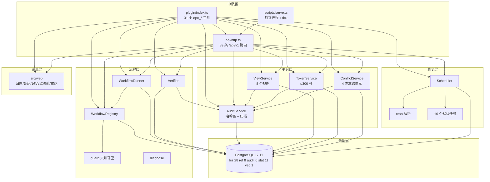

完整组件图（含 Phase 2 占位与 schema 细化）见 [docs/uml/opc-architecture.mmd](uml/opc-architecture.mmd)。

### 2.3 模块划分与依赖方向

`spec/opc-xuanji/modules.yaml` 登记 20 条模块条目；本仓库 `src/` 落地 8 条（platform、db、audit、workflow、scheduler、web、employees、api）加 1 条装配条目 plugin，**依赖方向单向向下，禁止反向 import**。

| 模块 | 职责 | 依赖 | src 落点 | 状态 |
| :--- | :--- | :--- | :--- | :--- |
| `platform` | 配置、.env 加载、错误码、审计、视图、令牌、冲突、稳定序列化 | 无 | `src/platform/` 8 文件 | 已实现 |
| `db` | 连接池、迁移链、事务助手 | platform | `src/db/` 2 文件 | 已实现 |
| `audit` | 审计哈希链、JSONL 导出、链头 | platform | `src/audit/audit.ts` | 已实现 |
| `workflow` | Registry、守卫、实例、Verifier、诊断 | platform | `src/workflow/` 5 文件 | 已实现 |
| `scheduler` | cron、任务引擎、默认任务 | platform、workflow | `src/scheduler/` 3 文件 | 已实现 |
| `api` | HTTP 契约层 | 全部上层 | `src/api/http.ts` | 已实现 |
| `plugin` | DSH cordis 装配、工具注册 | api | `src/plugin/index.ts` | 已实现 |
| `finance` `legal` `admin` `strategy` `crm` `inventory` `vehicle` `wbs` `publicity` | 九条业务线（项目/情报另有局部实现） | platform | 无目录 | Phase 2 |
| `project` / `intel` | 项目研发要素、情报日报规则流水线 | platform、scheduler | `src/domains/project/software.ts`、`src/domains/intel/daily.ts` | 局部实现；外部执行器/采集器 Phase 2 |

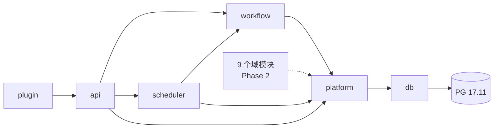

依赖方向的判据：`src/platform` 不 import `src/workflow`；`src/workflow` 不 import `src/scheduler`；`src/api` 只做参数校验与结果封装，业务规则全在下层。评审时用一条命令即可自查：

```bash
cd /path/to/opc-xuanji
grep -rn "from \"\.\./workflow\|from \"\.\./scheduler" src/platform/ || echo "platform 无反向依赖：PASS"
grep -rn "from \"\.\./scheduler" src/workflow/ || echo "workflow 无反向依赖：PASS"
```

## 3. 关键机制设计

### 3.1 流程注册与六项准入守卫

注册是唯一能改变“可执行流程集合”的入口，因此守卫放在**写库之前**：守卫不过 → 拒绝注册 → 写审计 → 抛 `ERR-WF-001`（422，`details.failures` 逐项）。守卫是纯函数 `evaluateGuard`（不碰数据库），便于单测（`test/unit/guard.test.ts` 9 例）。

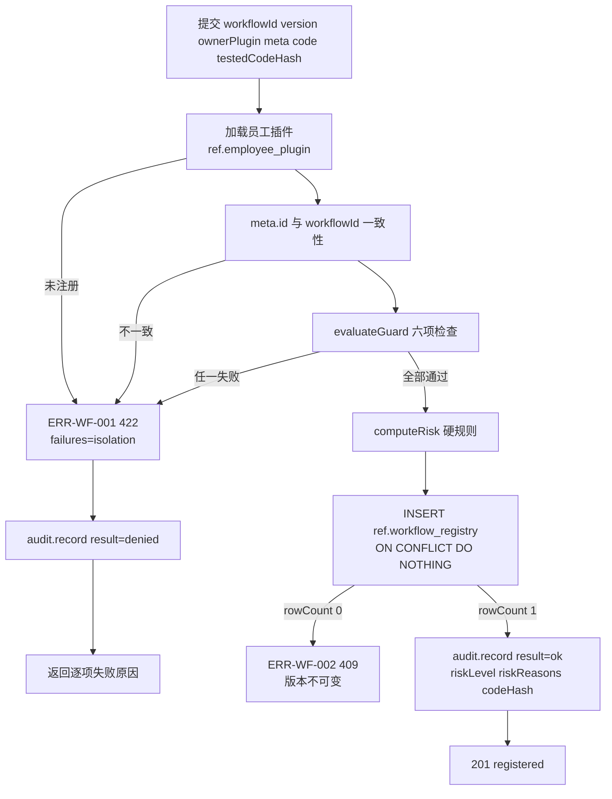

六项守卫的具体判据（`src/workflow/guard.ts`）：

| 守卫项 | 校验内容 | 失败示例（实测文案） |
| :--- | :--- | :--- |
| `meta_schema` | 7 个必需字段（`id/version/name/owner_plugin/scope/required_views/key_nodes`）非空；`scope ∈ {single,cross}`；节点名符合 `verb_noun` 正则；`human_gates` 必须在 `key_nodes` 内；`deadline_impact` 必须是布尔；**meta 出现 `risk_level` 直接拒绝** | `meta 中出现 risk_level：风险等级只允许 Registry 硬规则计算` |
| `views` | `required_views` 每个都要在 `VIEWS`（8 个）内，且在该员工的 `required_views` 内 | `视图 view_ar_ap 未授权给 opc_legal` |
| `idempotency` | 所有 `write_nodes` 都必须出现在 `idempotent_nodes` | `写节点 write_ledger 未登记幂等键` |
| `tools` | `meta.tools` 必须是员工注册的 `tools` 子集 | `工具 db_write 未在 opc_finance 注册` |
| `isolation` | `owner_plugin` = 员工；`single` 员工只能注册 `scope=single`；`private_refs` 必须为空；员工未停用 | `流程引用了其他员工私有数据：opc_crm` |
| `code_hash` | `sha256(code)` 必须等于提交的 `testedCodeHash` | `代码哈希不一致：测试通过=ab12…，当前=cd34…` |

风险等级**不由流程自述**，由 `computeRisk` 按写目标域硬算：

| 判据（满足任一即 high） | 来源 |
| :--- | :--- |
| `deadline_impact = true` | meta |
| 含 `human_gates` | meta |
| 员工 `write_targets` 命中高风险域 `ledger` / `contract` / `customer_sensitive` / `audit_log` / `token` | `ref.employee_plugin.write_targets` |
| 存在下游依赖流程 `depends_on_workflows` | meta |
| 单次涉及金额 > 月均流水 × 5% | meta + 调用方传入 `monthlyFlow` |
| 否则命中中风险域 `stock_txn` / `vehicle_log` / `subsidy_standard` / `ar_ap` / `tax_calendar`，或 `scope=cross` → medium；都不命中 → low | 同上 |

```bash
# 注册一个流程版本（守卫失败会返回 422 与 failures 数组）
curl -s -X POST http://127.0.0.1:3082/api/v1/workflows \
  -H 'content-type: application/json' \
  -d '{
    "workflowId": "tax_monthly_prepare",
    "version": "1.3.0",
    "ownerPlugin": "opc_finance",
    "testedCodeHash": "<sha256(code)>",
    "code": "export const meta = {...}",
    "monthlyFlow": 200000,
    "meta": {
      "id": "tax_monthly_prepare", "version": "1.3.0", "name": "月度税务申报准备",
      "owner_plugin": "opc_finance", "scope": "single",
      "required_views": ["view_ar_ap"], "key_nodes": ["collect_invoices", "reconcile"],
      "human_gates": [], "deadline_impact": true,
      "idempotent_nodes": ["write_ledger"], "write_nodes": ["write_ledger"]
    }
  }'
```

### 3.2 流程实例与幂等节点

幂等键 = `instance_id + node_id`，落在 `audit.workflow_node_run` 的唯一约束 `(instance_id, node_id)` 上。**判定靠唯一约束而不是先查后写**，并发安全。

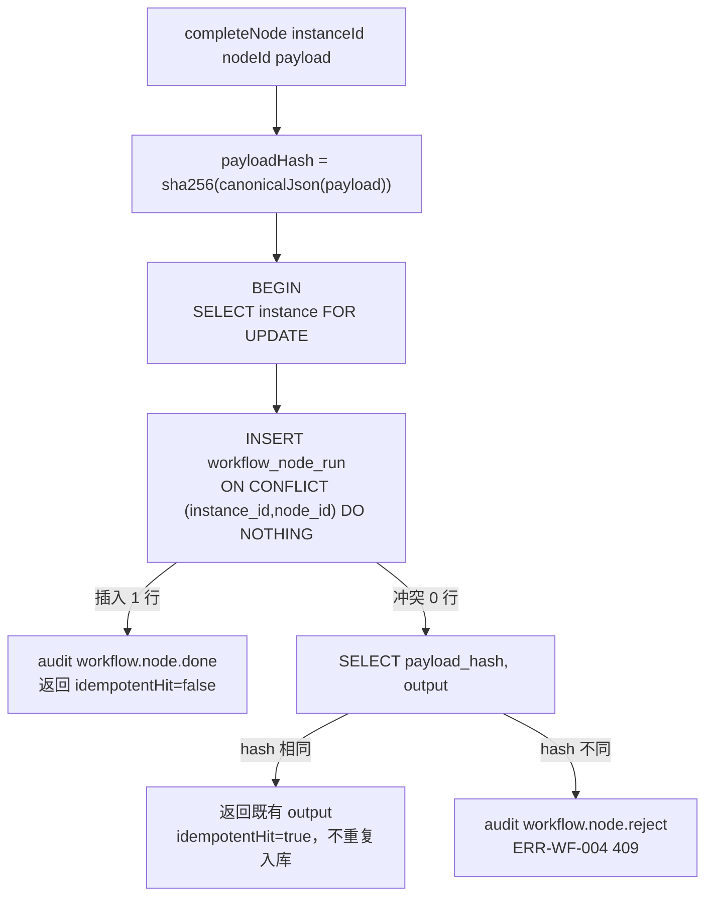

| 场景 | 结果 | 审计动作 | 幂等命中 |
| :--- | :--- | :--- | :--- |
| 首次提交该节点 | 写入，`status=done` | `workflow.node.done` / ok | false |
| 重复提交、入参一致 | 返回既有 `output`，不新写 | 无（只在首次写） | true |
| 重复提交、入参不同 | 拒绝 | `workflow.node.reject` / denied | false |
| 实例不存在 | 拒绝 | 无 | `ERR-WF-003` 404 |

```bash
# 启动实例 → 提交节点 → 重复提交看幂等命中
curl -s -X POST http://127.0.0.1:3082/api/v1/workflows/tax_monthly_prepare/instances \
  -H 'content-type: application/json' -d '{"context":{"period":"2026-11"}}'
# 假设返回 instanceId=1
curl -s -X POST http://127.0.0.1:3082/api/v1/instances/1/nodes/write_ledger/complete \
  -H 'content-type: application/json' -d '{"payload":{"amount":1234.56}}'
curl -s -X POST http://127.0.0.1:3082/api/v1/instances/1/nodes/write_ledger/complete \
  -H 'content-type: application/json' -d '{"payload":{"amount":1234.56}}'   # idempotentHit=true
curl -s -X POST http://127.0.0.1:3082/api/v1/instances/1/nodes/write_ledger/complete \
  -H 'content-type: application/json' -d '{"payload":{"amount":9999.00}}'   # ERR-WF-004 409
```

实例状态机（`audit.workflow_instance.status`，6 个取值）：`running` 起，`finish` 只能从 `running` 迁移到 `completed` / `failed` / `blocked` / `awaiting_decision`；重复 `finish` 返回 `ERR-WF-003`（404）。`rolled_back` 是 Phase 2 分阶段回滚的目标状态，当前无代码路径写入。

### 3.3 Verifier 评判

Verifier 是**中枢平台能力**，不是员工：它不注册业务工具、不派工竞争。当前实现是“聚合器 + 去重缓存”，采样本身由调用方给出（真实 LLM 裁判调用是 Phase 2，见 10.1）。

| 规则 | 实现 | 说明 |
| :--- | :--- | :--- |
| 多数票 | `confidence = max(pass, fail) / samples.length`，保留 4 位小数 | 平票（1:1）时 `pass >= fail` 判 pass |
| 高影响升级 | `escalated` = highImpact 且（票分裂 或 confidence 小于阈值） | 分裂票或低置信一律升人工，**不以低分差自动通过** |
| 默认阈值 | `DEFAULT_THRESHOLD = 0.8` | 可由请求体 `threshold` 覆盖 |
| 证据缓存 | 以 `sha256(canonicalJson(evidence))` + `node_id` 查 `audit.verifier_verdict` | 命中只省调用，**不改判定**：返回首次完整采样的 verdict |
| 采样不能为空 | `samples.length === 0` → `ERR-WF-001` 400 | 防止“零采样默认通过” |

```bash
# 高影响节点三次采样：2 pass / 1 fail → confidence 0.67 < 0.8 → escalated
curl -s -X POST http://127.0.0.1:3082/api/v1/instances/1/nodes/reconcile/verdict \
  -H 'content-type: application/json' \
  -d '{"nodeId":"reconcile","samples":["pass","pass","fail"],"evidence":{"invoice_total":100,"ledger_total":100},"highImpact":true}'
```

返回体含 `finalVerdict / confidence / escalated / verdictId / cacheHit / evidenceHash / sampling` 七项，审计同时落一条 `verifier.judge`（含 `samples` 与 `confidence`）。

### 3.4 视图级授权与一次性令牌

授权粒度 = **视图级**（8 个视图），不做字段级；敏感原文只走令牌。判定条件两条同时成立：员工在 `ref.employee_plugin` 且 `enabled`，以及在 `ref.view_grant` 有 `status='active'` 的授权。

| 视图 | 内容 | 过滤字段 | 行数上限 |
| :--- | :--- | :--- | :--- |
| `view_company_profile` | 公司档案（非敏感） | 无 | 200 |
| `view_ar_ap` | 应收应付（按相对方+状态聚合） | `status` | 200 |
| `view_project_status` | 项目阶段/进度/成本 | `stage` | 200 |
| `view_customer_base` | 客户基础信息（**不 JOIN 敏感表**） | `sensitivity_level` | 200 |
| `view_contract_index` | 合同索引（不含条款正文） | `status` | 200 |
| `view_stock_index` | SKU 与库存汇总 | 无 | 200 |
| `view_vehicle_index` | 用车汇总（费用脱敏为汇总） | `plate` | 200 |
| `view_okr` | 目标与关键结果（只读） | `period` | 200 |

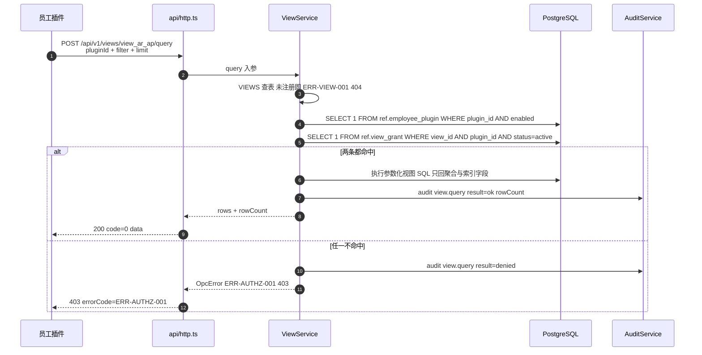

一次性令牌的硬约束（`src/platform/token.ts`）：绑定单次 `task_id`、单字段范围、有效期 **≤ 300 秒**（`MAX_TTL_SECONDS`）、消费一次即 `used=true`、对外只认 `token_code`（`randomBytes(16)` 的 32 位 hex）、审计只落令牌 id 与字段名不落字段值。

```bash
# 签发 → 消费 → 重复消费
curl -s -X POST http://127.0.0.1:3082/api/v1/tokens -H 'content-type: application/json' \
  -d '{"taskId":"task-1","pluginId":"opc_crm","viewId":"view_customer_base","fieldScope":["home_address"],"customerId":1,"ttlSeconds":60}'
curl -s -X POST http://127.0.0.1:3082/api/v1/tokens/<token_code>/consume \
  -H 'content-type: application/json' -d '{"taskId":"task-1"}'
curl -s -X POST http://127.0.0.1:3082/api/v1/tokens/<token_code>/consume \
  -H 'content-type: application/json' -d '{"taskId":"task-1"}'   # 409 令牌已使用
```

### 3.5 冲突冻结与裁决

冻结粒度 = **最适宜老板评判的业务事件**。代码里可冻结的单元恰好 4 类，且每类都有 `conflict_frozen` 列（`ledger` / `contract` / `stock_txn` / `vehicle_log`）。

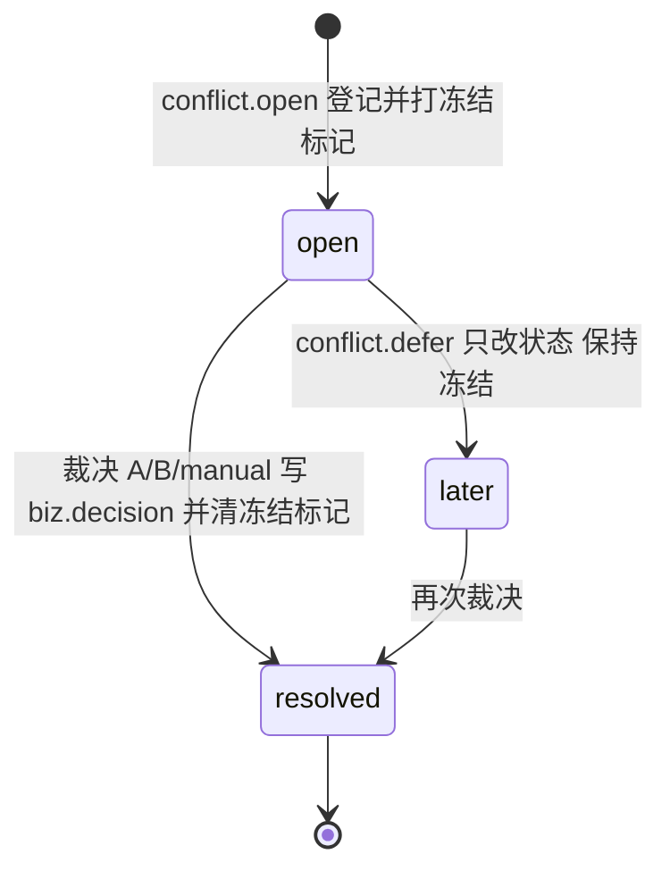

| 环节 | 行为 | 数据落点 |
| :--- | :--- | :--- |
| 登记 | 校验冲突类型（4 类）与冻结单元（4 类）存在、`parties` ≥ 2 条；`SELECT … FOR UPDATE` 锁冻结单元后插队列并打冻结标记 | `biz.conflict_queue` + 对应业务表 |
| 汇总 | **不剔除**冻结记录：返回 `total_including_frozen`、`effective_total`、`frozen_items[]` 三个值，由渲染层出“总额（含冻结）+ 脚注” | 单条聚合 SQL，`FILTER (WHERE NOT conflict_frozen)` |
| 裁决 | 选 `A`/`B`/`manual` 时写 `biz.decision` 并把 `arbitration_id` 回写、清冻结标记；选 `later` 只改状态、**保持冻结** | `biz.decision` + `biz.conflict_queue` |
| 幂等 | 已 `resolved` 的冲突再次裁决直接返回 `resolved`，不重复写裁决记录 | `conflict.status` 判定 |

```bash
# 登记冲突 → 看含冻结总额 → 裁决
curl -s -X POST http://127.0.0.1:3082/api/v1/conflicts -H 'content-type: application/json' \
  -d '{"conflictType":"cost","frozenUnitType":"ledger","frozenUnitId":1,"parties":[{"pluginId":"opc_finance"},{"pluginId":"opc_project"}],"diffFields":["project_id"]}'
curl -s -X POST http://127.0.0.1:3082/api/v1/conflicts/1/resolve -H 'content-type: application/json' \
  -d '{"choice":"A","note":"按合同归属"}'
```

### 3.6 审计哈希链

审计是**唯一写入口**：员工插件不直写审计库，一律经 `AuditService.record`。每条记录带 `prev_hash` 成链，写链用事务级 advisory lock 串行化，避免并发分叉；链头持久化在 `audit.audit_chain_head`。

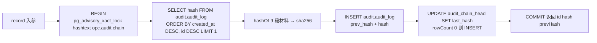

哈希材料的**顺序固定**（顺序变了历史链立刻校验失败）：

| # | 段 | 说明 |
| :--- | :--- | :--- |
| 1 | `prev_hash`（空串表示链首） | 前一条记录的 hash |
| 2 | `actor` | 操作者 |
| 3 | `action` | 动作 |
| 4 | `result` | `ok` / `denied` / `error` |
| 5 | `schema_version` | 归档可迁移口径 |
| 6 | `workflow_instance_id`（空串表示无） | 流程维度 |
| 7 | `test_mode`（`1` / `0`） | 测试数据标记 |
| 8 | `canonical(payload)` | 键名排序后的稳定 JSON |
| 9 | `created_at`（ISO 字符串） | 时间戳 |

九段用竖线 `|` 连接后取 sha256。校验入口是 `verifyChain()`：逐条重算并与库内 `prev_hash` / `hash` 比对，任何一条不一致返回 `{ok:false, brokenAt}`，最后再核对链头。

```bash
# 写一条审计并立刻校验全链
node --input-type=module -e '
import { createPool } from "./src/db/pool.ts";
import { AuditService } from "./src/platform/audit.ts";
import { loadConfig } from "./src/platform/config.ts";
const cfg = loadConfig();
const pool = createPool(cfg.dsn, { max: 2 });
const audit = new AuditService(pool, { schemaVersion: cfg.schemaVersion });
console.log(await audit.record({ actor: "opc_hub", action: "demo.write", result: "ok", payload: { a: 1 } }));
console.log(await audit.verifyChain());
await pool.end();
'
```

## 4. 端到端时序

### 4.1 注册 → 准入守卫 → 实例 → 幂等节点 → Verifier → 审计

一条流程版本的完整生命周期分六个阶段，每一阶段都以一条审计记录收尾（成功与拒绝都写）。完整时序源码见 [docs/uml/opc-workflow-sequence.mmd](uml/opc-workflow-sequence.mmd)，下面给出压缩版与“每步的审计动作”对照。

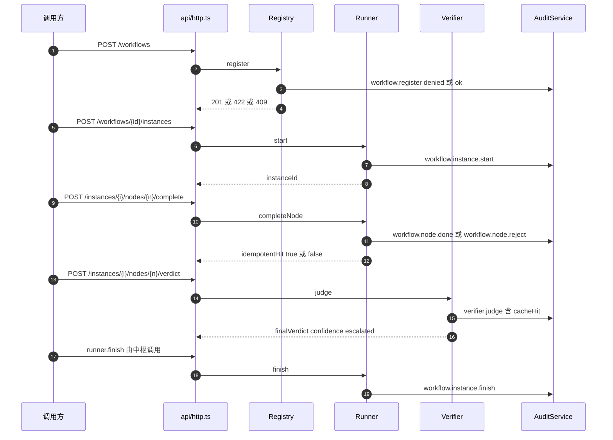

| 阶段 | 触发 | 关键校验 | 审计 action / result | 失败去向 |
| :--- | :--- | :--- | :--- | :--- |
| 注册 | `POST /workflows` 201 | 员工存在 → meta.id 一致 → 六项守卫 → 风险硬算 → 唯一版本 | `workflow.register` / ok 或 denied | 422 `ERR-WF-001`、409 `ERR-WF-002` |
| 启实例 | `POST /workflows/{id}/instances` 201 | 版本必须已注册（缺省取最新） | `workflow.instance.start` / ok | 404 `ERR-WF-003` |
| 跑节点 | `POST /instances/{i}/nodes/{n}/complete` 200 | 实例存在 → 幂等键 → 入参哈希 | `workflow.node.done` / ok；`workflow.node.reject` / denied | 404 `ERR-WF-003`、409 `ERR-WF-004` |
| 评判 | `POST /instances/{i}/nodes/{n}/verdict` 200 | 采样非空 → evidence 去重 → 多数票/升级 | `verifier.judge` / ok（含 cacheHit） | 400 `ERR-WF-001` |
| 收尾 | `runner.finish` | 只允许从 `running` 迁移 | `workflow.instance.finish` / ok | 404 `ERR-WF-003` |
| 旁路 | 视图/令牌/冲突/任务 | 见第 3、5 章 | `view.query`、`token.issue`、`token.consume`、`conflict.open`、`conflict.resolve`、`conflict.defer`、`task.run` | 见第 6 章 |

一条可复制的端到端脚本（起服务后顺序执行，实测输出见括注）：实例号与哈希都在脚本内算出，不写死。

```bash
cd /path/to/opc-xuanji
DB="$OPC_TEST_DSN"
BASE=http://127.0.0.1:3082/api/v1

# 0) 种子：员工插件 + 视图授权（同一对值集成测试也用）
psql "$DB" -q <<'SQL'
INSERT INTO ref.employee_plugin (plugin_id, display_name, scope, required_views, tools, write_targets)
VALUES ('opc_finance','财税管家','single','["view_ar_ap"]','["opc_view_query"]','["ledger"]')
ON CONFLICT (plugin_id) DO NOTHING;
INSERT INTO ref.view_grant (view_id, plugin_id) VALUES ('view_ar_ap','opc_finance')
ON CONFLICT (view_id, plugin_id) DO NOTHING;
SQL

# 1) 算出代码哈希（守卫要求 testedCodeHash == sha256(code)）
CODE='export const meta = {"id":"demo_flow"};'
HASH=$(node -e 'const c=require("crypto");process.stdout.write(c.createHash("sha256").update(process.argv[1]).digest("hex"))' "$CODE")
BODY=$(node -e '
const [code,hash]=process.argv.slice(1);
console.log(JSON.stringify({workflowId:"demo_flow",version:"1.0.0",ownerPlugin:"opc_finance",testedCodeHash:hash,code,
  meta:{id:"demo_flow",version:"1.0.0",name:"演示流程",owner_plugin:"opc_finance",scope:"single",
        required_views:["view_ar_ap"],key_nodes:["write_ledger"],human_gates:[],deadline_impact:true,
        idempotent_nodes:["write_ledger"],write_nodes:["write_ledger"]}}));' "$CODE" "$HASH")

# 2) 注册 → 3) 启实例（拿回 instanceId）→ 4) 幂等节点 → 5) 评判 → 6) 按实例查审计
curl -s -X POST $BASE/workflows -H 'content-type: application/json' -d "$BODY"
INST=$(curl -s -X POST $BASE/workflows/demo_flow/instances -H 'content-type: application/json' -d '{"context":{}}' \
  | node -e 'let s="";process.stdin.on("data",d=>s+=d).on("end",()=>console.log(JSON.parse(s).data.instanceId))')
curl -s -X POST $BASE/instances/$INST/nodes/write_ledger/complete -H 'content-type: application/json' -d '{"payload":{"amount":1}}'
curl -s -X POST $BASE/instances/$INST/nodes/write_ledger/complete -H 'content-type: application/json' -d '{"payload":{"amount":1}}'
curl -s -X POST $BASE/instances/$INST/nodes/write_ledger/complete -H 'content-type: application/json' -d '{"payload":{"amount":2}}'
curl -s -X POST $BASE/instances/$INST/nodes/write_ledger/verdict -H 'content-type: application/json' \
  -d '{"nodeId":"write_ledger","samples":["pass","pass","fail"],"evidence":{"amount":1},"highImpact":true}'
curl -s "$BASE/audits?instanceId=$INST&limit=10"
```

实测输出（2026-11-05，`opc_test`）：注册返回 `riskLevel: high`、`riskReasons` 两条（`deadline_impact=true`、写入目标域 `ledger`）；节点首次 `idempotentHit=false`，重复提交 `idempotentHit=true` 且返回同一 `output`，改入参返回 409 `ERR-WF-004`；评判返回 `finalVerdict=escalated`、`confidence=0.6667`、`escalated=true`；审计按实例聚合可查到 `workflow.instance.start`、`workflow.node.done`、`verifier.judge` 三类记录。

### 4.2 审计与归档时序

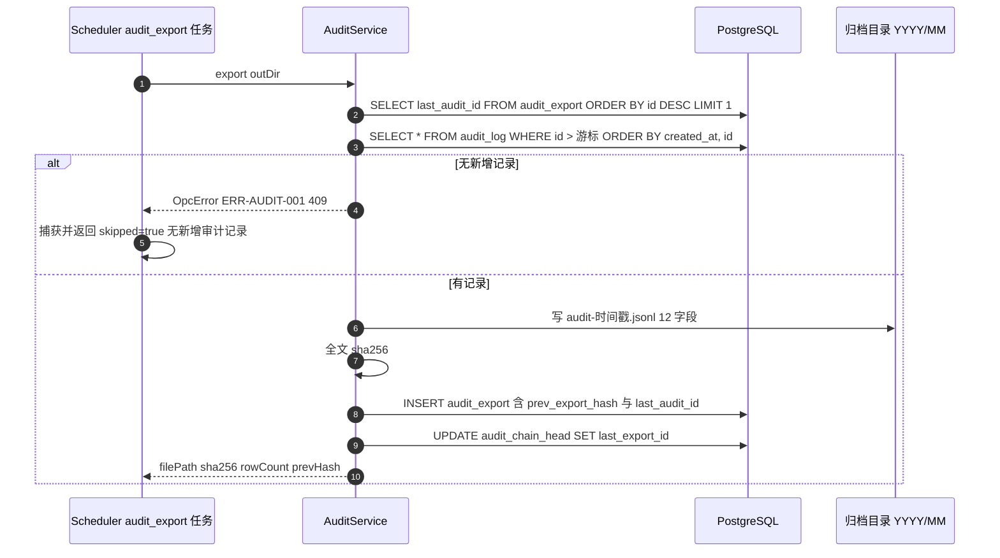

归档的三个不可变约定：目录**只追加不覆盖**（文件名带 ISO 时间戳）；导出文件 sha256 与 `prev_export_hash` 构成归档链；`last_audit_id` 是下一次的游标，**重复导出不会重复计费**。产品设计要求的人工重试 3 次后即时告警属于调度层策略，目前由任务失败路径（`stat.task_run.status=failed` + `stat.notification` instant）承接，自动重试计数未实现，见 10.1。

## 5. 调度器设计

### 5.1 cron 解析规则

不引第三方 cron 库，自己实现 5 字段解析与“严格晚于 from 的下一次触发”（`src/scheduler/cron.ts`，单测 7 例）。

| 字段 | 位 | 取值 | 支持语法 |
| :--- | :--- | :--- | :--- |
| 分 | 1 | 0–59 | `*`、`*/n`、`a-b`、`a-b/n`、列表 `a,b` |
| 时 | 2 | 0–23 | 同上 |
| 日 | 3 | 1–31 | 同上 |
| 月 | 4 | 1–12 | 同上 |
| 周 | 5 | 0–7（0 与 7 都是周日，内部归一为 0） | 同上 |

| 规则 | 口径 |
| :--- | :--- |
| 字段数 | 必须正好 5 段，否则 `ERR-TASK-002` 400（`cron 必须是 5 字段（分 时 日 月 周）`） |
| 日/周同时受限 | 按 cron 惯例取**或**：日与周同时受限时，命中日 **或** 命中周即可 |
| 时区 | IANA 名（默认 `Asia/Shanghai`），用 `Intl.DateTimeFormat` 探测本地分量，不依赖 `TZ` 环境变量 |
| 搜索窗口 | 逐日最多看 400 天，找不到触发时刻抛 `ERR-TASK-002`（`cron 在 400 天内无触发时刻`） |
| 严格递增 | 结果必须严格大于 `from`（同一分钟不会重复触发） |

```bash
# 解析与“下次触发”自查（不写库）
node --input-type=module -e '
import { parseCron, nextRun, describeCron } from "./src/scheduler/cron.ts";
const expr = "30 8 * * 1-5";
console.log(describeCron(expr));
console.log([...parseCron(expr).daysOfWeek].sort());
console.log(nextRun(expr, "Asia/Shanghai", new Date("2026-11-04T22:00:00Z")).toISOString());
'
# 预期 工作日 08:30 / [1,2,3,4,5] / 2026-11-05T00:30:00.000Z
```

### 5.2 任务配置、幂等键与 force 重跑

任务是**配置驱动**的：任务类型（代码）与调度配置（库）分离，老板可改 cron、时区、启用状态与参数，但不能凭空新增任务类型。

| 行为 | 实现 | 结果 |
| :--- | :--- | :--- |
| 首次落配置 | `seedDefaults()`：`INSERT … ON CONFLICT (task_id) DO NOTHING` | 只补缺失，不覆盖老板改过的配置 |
| 改配置 | `upsert()`：先 `parseCron` 校验，再 `ON CONFLICT (task_id) DO UPDATE`，同时重算 `next_run_at` | 未注册任务类型 → `ERR-TASK-002` 400 |
| 幂等键 | `(task_id, scheduled_at)`，`INSERT … ON CONFLICT DO NOTHING` | 撞键即跳过，返回既有 `runId`，`skipped=true` |
| 立即执行 | `run(taskId)`：`scheduledAt` 缺省取“当前分钟向下取整” | 同一分钟内重复点“立即执行”只跑一次 |
| 强制重跑 | `force=true`：计划时间 **+1 毫秒**，最多试 3 次 | 生成新幂等键，历史记录保留不覆盖 |
| 失败 | 捕获异常 → `status=failed` + `error` + `notify("task_failed","instant")` + 审计 `result=error` → 重新抛出 | 调用方拿到异常，失败不被吞掉 |
| 到点推进 | `tick(now)`：取 `enabled AND next_run_at <= now`，逐个 `run`，再写 `last_run_at` 与新的 `next_run_at` | 单次 tick 内同一任务只跑一次 |

```bash
# 立即执行（幂等）→ 强制重跑 → 查运行记录
curl -s -X POST http://127.0.0.1:3082/api/v1/tasks/daily_report/run -H 'content-type: application/json' -d '{}'
curl -s -X POST http://127.0.0.1:3082/api/v1/tasks/daily_report/run -H 'content-type: application/json' -d '{"force":true}'
psql "$OPC_PG_DSN" -c \
  "select task_id, scheduled_at, status, attempt from stat.task_run order by id desc limit 5;"
```

### 5.3 tick 推进时序

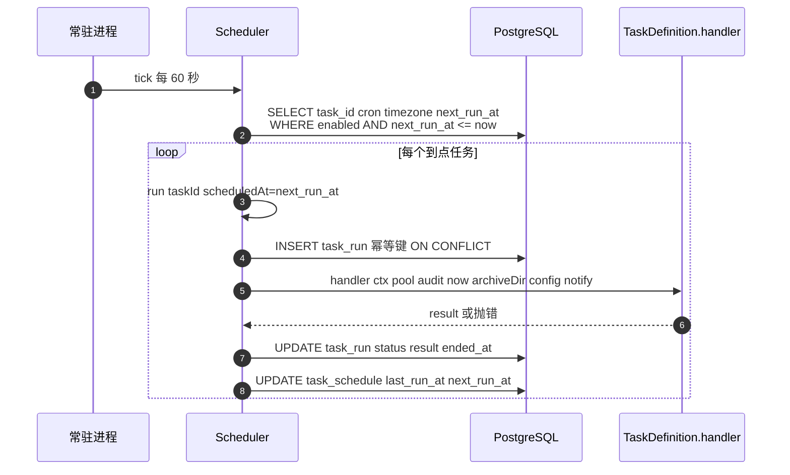

### 5.4 十个默认任务（配置驱动，老板可改）

| 任务 id | 名称 | 默认 cron | 时区 | 产出 |
| :--- | :--- | :--- | :--- | :--- |
| `daily_report` | 每日晨报 | `30 8 * * 1-5` | Asia/Shanghai | 写 `stat.daily_report`（税务 ≤7 天、合同 ≤30 天、待裁决冲突、升级统计）+ 通知 |
| `tax_reminder` | 税务申报预警 | `0 9 * * *` | Asia/Shanghai | 有命中才入队通知 |
| `contract_expiry` | 合同到期提醒 | `0 9 * * *` | Asia/Shanghai | 有命中才入队通知 |
| `invoice_backlog` | 缺票积压 | `0 10 * * 5` | Asia/Shanghai | 金额超 `invoiceBacklogThreshold` 才通知 |
| `conflict_escalation` | 冲突超期提醒 | `0 * * * *` | Asia/Shanghai | >7 天每日、>30 天标 `monthly` |
| `audit_export` | 审计增量导出 | `0 2 * * *` | Asia/Shanghai | JSONL 到 `<archiveDir>/audit/YYYY/MM/` |
| `monthly_archive` | 月度归档 | `0 3 1 * *` | Asia/Shanghai | 追加一次导出 + info 通知 |
| `dashboard_refresh` | 驾驶舱刷新 | `*/15 * * * *` | Asia/Shanghai | 写 `stat.dashboard_snapshot`；失败保留上次并标 `stale` |
| `plugin_radar_scan` | DSH 插件雷达 | `0 6 * * 1` | Asia/Shanghai | 合格候选写 `stat.radar_item`；只推荐不安装 |
| `keyword_radar_scan` | 关键词雷达 | `0 7 * * *` | Asia/Shanghai | 关键词条目写 `stat.radar_item`；未配置源则“本次未检索” |

```bash
# 列任务（应看到 10 条，含 nextRunAt 与最近状态）
curl -s http://127.0.0.1:3082/api/v1/tasks | head -c 300
# 改一个任务的 cron 与参数
curl -s -X PUT http://127.0.0.1:3082/api/v1/tasks/invoice_backlog -H 'content-type: application/json' \
  -d '{"cron":"0 10 * * 5","timezone":"Asia/Shanghai","enabled":true,"config":{"invoiceBacklogThreshold":5000}}'
```

### 5.5 Web 表现层服务设计（v2.10）

**新增模块**：`src/web/`（5 个文件）——`classifier.ts`（规则分类/抽取/归置决策）、`plugin-score.ts`（插件硬过滤与评分）、`dashboard.ts`（只读聚合快照）、`services.ts`（归置/会话/记忆/雷达服务）。

**装配**：`createHub` 实例化 `web` 服务并挂到 `ApiContext`；HTTP P17–P28、DSH 工具 `opc_web_*`、调度任务 `dashboard_refresh`/`plugin_radar_scan`/`keyword_radar_scan` 共用同一批实例。

**数据流**：

```
中间会话/上传
  → IngestService.classifyText + extractFields
  → decideIngest：auto_draft / confirm / inbox
  → stat.web_ingest_item（高风险域确认前不写业务表）
  → 老板确认 → 审计 → dashboard_refresh 读模型

右栏驾驶舱
  → DashboardService.snapshot(range)
  → REPEATABLE READ 只读事务聚合 biz/audit/stat
  → stat.dashboard_snapshot（as_of / stale / warnings）

会话/记忆
  → ref.web_session_grant（用途 + TTL）→ stat.web_session_message（最近 20 条）
  → stat.web_memory_proposal（先提议）→ 老板确认 → stat.web_memory_card
  → 敏感记忆只返回标记
```

**适配层**：`WebHostAdapter` 三档——原生插槽 → sandbox iframe + postMessage → 降级独立页；面板不直连 DB。真实 DSH 插槽/会话事件仍需端到端核对（§10.1）。

**调度**：`dashboard_refresh` 每 15 分钟 + 事件触发；`plugin_radar_scan` 每周一 06:00；`keyword_radar_scan` 每日 07:00。任务领取用短事务 `FOR UPDATE SKIP LOCKED`，不使用 advisory lock；`(task_key, scheduled_at)` 唯一幂等。未配置检索源时明确返回“本次未检索”。

**失败路径**：聚合失败保留上次快照并标 `stale`；分类/抽取失败全部进收件箱；会话未授权 403；雷达检索失败标注“未检索”；面板停用不影响中枢/员工/Workflow。

### 5.6 员工插件目录与员工包（v2.11）

**新增模块**：`src/employees/`——`catalog.ts`（11 个员工 manifest + 校验）、`package.ts`（目录/安装/停用/员工包导入导出）。

**manifest 校验**：`pluginId/employeeCode/version/minHubVersion/schemaVersion/requiredViews/tools/writeTargets/singleWorkflows/dependencies`；视图必须在 `knownViewIds()` 内，写目标必须在登记表内，工具名与流程名符合命名规则。

**生命周期**：安装默认停用 → 老板显式启用；停用前检查依赖插件（如 WBS 依赖项目、外宣依赖项目/客户），有依赖则拒绝；卸载默认保留业务数据并转只读。

**员工包**：`opc-employee-package` v1（JSON 信封：manifest + files[] + checksum）；导入校验格式/大小/checksum/manifest/依赖/视图/工具/写目标/路径穿越 → dry-run 报告 → 老板确认 → 事务内写 `ref.employee_package`、`ref.employee_import_job`、`ref.employee_plugin`（默认停用）→ 二次确认启用。默认不含业务数据、凭据、客户敏感信息。

**API/工具**：P29–P34；`opc_employee_list/install/toggle/export/import`；与员工目录服务共用同一实例。

### 5.7 管理面 BFF 与驾驶舱统计（v2.14）

- `AdminService`（`src/domains/admin/service.ts`）以资源白名单复用 CRUD：项目子资源（里程碑/版本库/制品库/环境/测试计划/用例/套件/缺陷/工时）与情报资源（空间/数据源/绑定/主题/标签）；所有写操作写 `actor=boss` 审计，凭据只存 `auth_ref`。
- 发布/测试批次/测试结果复用 `ProjectSoftwareService` 的既有校验；情报流水线手动触发复用 `IntelPipelineService` 的 `force + projectId` 过滤。
- 公司基础资源（v2.15）：`AdminService` 新增 `SHARED_DEF` 资源定义与 `sharedDefaults` / `listSharedResources` / `createSharedResource` / `updateSharedResource` / `removeSharedResource` / `listProjectSharedResources` / `bindProjectSharedResources` / `unbindProjectSharedResource` 方法；六类共享资源（版本库/制品库/测试服务器/NAS/公网服务器/域名）登记在 `ref.shared_resource`，公司默认口径（debian / ssh / canetwork / 凭据引用）存 `ref.shared_setting`，项目绑定存 `ref.project_shared_resource`；`createProject` 默认按 `is_default + active` 选型绑定，`resourceIds` 可显式覆盖。口令只以 `env:/secret:/vault:/ssh-agent:` 引用登记，实际口令由部署环境注入。
- 项目自动驾驶（v2.16）：`ProjectAutopilotService`（`src/domains/project/autopilot.ts`）串联「登记版本库 → 浅克隆（`git clone --depth 1`，超时 120s，env: 凭据经临时 askpass）→ 静态扫描（只读文件，上限 2000 文件，跳过 `.git/node_modules/dist`）→ 回填 `tech_stack/software_profile` → 生成三份计划（dev 里程碑 + test 计划与基线用例 + deploy 复用公司默认测试服务器）→ 裁决项入队」。检出/扫描/计划/裁决分别落 `ref.project_checkout`、`stat.project_scan`、`stat.project_plan`、`stat.project_decision`；检出失败返回 502 且不伪造档案。
- 自动化生产（v2.17）：在自动驾驶基础上追加三步——`generateScaffold`（仅补缺失骨架并提交本地分支 `opc/autopilot-*`，不推远端）、`runPipeline`（识别 lint/build/test 脚本，300s 超时 + 最小环境 + 默认不装依赖，逐阶段落 `stat.project_pipeline_run`）、`deployTestEnvironment`（建测试环境发布单，执行 `OPC_TEST_DEPLOY_CMD` 或显式命令并做健康检查，无命令转裁决）。三者失败均生成 high 风险裁决，不伪造成功。
- 运维反馈（v2.18）：`UsageService` 在 HTTP 入口记录动作/状态/耗时（不记请求体），按天聚合后由规则 + 可选 AI（OpenAI 兼容端点，只发聚合统计）产出 [体验]/[需求]/[流程] 草稿；`IssueReporter` 对 5xx 运行错误按指纹去重，草稿经 GitHub API 投递（单轮 5 / 单日 20，正文脱敏，未配置 token 标 skipped）。定时任务 `issue_autofile`（每 30 分钟）与 `usage_insight`（每周一 09:00）驱动。
- 已建项目接入（v2.19）：`POST /admin/projects/{projectId}/autopilot` 对已有项目同样可用；重复执行时复用同 URL 版本库、测试环境，里程碑/测试计划用例/裁决按去重规则跳过，计划按 `(project_id, plan_kind)` 版本递增。管理面「自动驾驶」页签增加「对已选项目执行」区块并自动预填已登记仓库。
- 创意转项目（v2.20）：`IdeaService`（`src/domains/project/idea.ts`）把文本/文档创意解析为项目档案（DeepSeek/OpenAI 兼容端点，失败降级规则）；`src/platform/documents.ts` 用 Node 内置 zlib 解析 docx/xlsx OOXML 与 PDF 文本层，不引入第三方依赖；`AdminService.createProjectFromIdea` 建项目、绑定默认资源，有仓库则串自动驾驶，无仓库则写 `repository` 裁决并落 `stat.project_idea`。管理面「自动驾驶」页签新增「从创意新建项目」卡片（多文件上传）。
- HTTP 管理面统一挂 `/api/v1/admin`，共 48 个 operation；Web 控制台 `client.js` 新增「项目管理」「情报管理」两个页签，驾驶舱新增项目研发与情报指标组。
- 删除保护：被发布单引用的环境、被批次引用的计划/套件、被结果引用的用例、仍被绑定的来源、已有条目的情报空间，删除返回 409。

## 6. 失败与降级路径

失败处理的第一原则是**不静默降级**：该拒就拒、该报就报，拒绝也要留痕。下表按失败来源分三组，逐条给出代码行为与最终返回。

### 6.1 输入与协议类失败

| 场景 | 代码行为 | 返回 |
| :--- | :--- | :--- |
| 请求体不是 JSON 对象 | `readBody` 捕获解析异常 | 400 `ERR-SYS-001`（`请求体必须是 JSON 对象`） |
| 请求体 > 1 MB | 累计字节超 `1_048_576` 即中断 | 413 `ERR-SYS-001` |
| 必填字段缺失/空串 | `requireString` 抛错 | 400 `ERR-SYS-001`（`字段 workflowId 必须是非空字符串`） |
| 未知路由 | 路由表未命中 | 404 `ERR-SYS-001` |
| cron 非法 / 未注册任务类型 | `parseCron` / `tasks.get` 抛错 | 400 `ERR-TASK-002` |
| 未知冻结单元类型 | `UNITS[...]` 未命中 | 400 `ERR-CONFLICT-001` |
| 令牌 TTL 不在 1..300 | `TokenService.issue` 校验 | 400 `ERR-TOKEN-001` |
| 视图不支持的过滤字段 | `assertKeys` 抛错 | 400 `ERR-VIEW-001` |

### 6.2 授权与业务规则拒绝

| 场景 | 代码行为 | 返回 | 审计 |
| :--- | :--- | :--- | :--- |
| 视图未授权 / 员工停用 | 先写 `view.query` denied 再抛错 | 403 `ERR-AUTHZ-001` | 有（含 pluginId 与 filter） |
| 未注册视图 | `VIEWS[viewId]` 未命中 | 404 `ERR-VIEW-001` | 无（请求未进入授权阶段） |
| 令牌重复消费 / 过期 / 任务不匹配 | 事务内 `FOR UPDATE` 后逐项判定 | 409 `ERR-TOKEN-001` | 有（`token.consume` denied，只落 reason 不落值） |
| 准入守卫失败 | 先写 `workflow.register` denied 再抛 | 422 `ERR-WF-001` + `failures[]` | 有（逐项失败原因） |
| 同版本重复注册 | 唯一约束冲突（`ON CONFLICT DO NOTHING` → 0 行） | 409 `ERR-WF-002` | 无（守卫已通过，未写 ok 记录） |
| 流程未注册 / 实例不存在 | 查询 0 行 | 404 `ERR-WF-003` | 无 |
| 幂等键同键异入参 | 比 `payload_hash` 不等 | 409 `ERR-WF-004` | 有（`workflow.node.reject` denied） |
| 重复 `finish` | `UPDATE … WHERE status='running'` 影响 0 行 | 404 `ERR-WF-003` | 无 |
| Verifier 采样为空 | `aggregateSamples` 抛错 | 400 `ERR-WF-001` | 无 |
| 冲突单元不存在 | `SELECT … FOR UPDATE` 0 行 | 404 `ERR-CONFLICT-001` | 无 |
| 空增量导出 | `export` 主动抛错 | 409 `ERR-AUDIT-001` | 无（任务侧转为 skipped） |

### 6.3 依赖与运行时失败

| 场景 | 代码行为 | 影响面 | 自动恢复 |
| :--- | :--- | :--- | :--- |
| PG 连接失败 | 池错误事件打 `[opc] pg pool idle error`；请求侧抛 `ERR-SYS-001` 500 | 全部接口 | 进程不崩，下个请求重试 |
| 迁移 checksum 不一致 | `migrate` 直接抛错并中止 | 迁移整体不执行 | 需回滚代码，不能跳过 |
| 任务执行抛错 | `task_run.status=failed` + `error` + instant 通知 + 审计 `error`，随后重新抛出 | 该次运行 | 失败时 `next_run_at` **不推进**；下一轮 `tick` 再次命中同一计划时间，但幂等键已存在，`run` 返回 `skipped`（status=failed），随后才推进——不会无限重跑，内容重跑需 `force=true` |
| 审计导出磁盘写失败 | 写文件抛错 → 导出事务未提交 → `task_run.failed` | 归档链停在上一文件 | 人工修权限后重跑任务（幂等键为计划时间，`force=true` 可重跑） |
| 进程内 `tick` 抛错 | `plugin.apply` 中 `catch` 打 warn；`serve.ts` 中打 `[opc] tick 失败` | 本轮 tick | 下一轮继续 |

### 6.4 降级路径对照（设计 vs 落地）

产品设计 8.5 定义了 11 条降级路径，当前代码的落地情况如下——**未落地的部分是 Phase 2，不是“已实现但未写文档”**。

| 降级场景 | 当前落点 | 状态 |
| :--- | :--- | :--- |
| Verifier 不可用 → 阻塞不降级为默认通过 | `Verifier.judge` 无 LLM 调用，采样由调用方给；空采样直接 400 | 阻塞语义已成立，LLM 侧 Phase 2 |
| Workflow 引擎不可用 → 快照生成人工清单 | 无快照导出代码 | Phase 2 |
| Registry 准入守卫失败 → 拒绝注册 | 已实现（422 + 审计 + `failures[]`） | 已落地 |
| 审计导出失败 → 即时告警 | 任务失败 → `stat.notification` instant | 已落地（自动重试 3 次未实现） |
| 令牌过期/超范围 → 拒绝 + 重发起 | 已实现（409 + 审计） | 已落地 |
| 外部 MCP 不可用 → 情报转人工队列 | 域模块未实现 | Phase 2 |
| 补贴官方源不可访问 → 沿用生效版本并标注 | 数据字段（`status`/`collected_at`）已备，采集流程未实现 | Phase 2 |
| 仅命中非官方来源 → 不纳入候选 | `official_source_type` CHECK 三值 + `status=candidate` 已备，判定流程未实现 | Phase 2 |
| 语音识别失败 → 转文本确认卡 | 无语音通道 | Phase 2 |
| 模型不可用 → 工具型照常、生成型排队 | 无模型调用面 | Phase 2 |
| 数据缺失 → 标注“数据不足”不猜测 | 诊断卡 `rootCause=data` 已实现（缺必填 evidence 时） | 部分落地 |

排障时先看这三处，比逐行读代码快：

```bash
cd /path/to/opc-xuanji
# 1) 健康检查：PG / pgvector / 已注册任务数
curl -s http://127.0.0.1:3082/api/v1/health
# 2) 最近失败的运行与原因
psql "$OPC_PG_DSN" -c \
  "select task_id, scheduled_at, status, error from stat.task_run where status='failed' order by id desc limit 5;"
# 3) 被拒绝的操作（审计里 result=denied 的全部条目）
psql "$OPC_PG_DSN" -c \
  "select created_at, actor, action, object_type, object_id from audit.audit_log where result='denied' order by created_at desc limit 10;"
```

## 7. 配置项与环境变量

### 7.1 环境变量（唯一事实来源：`src/platform/config.ts`）

| 变量 | 是否必填 | 默认值 | 用途 |
| :--- | :--- | :--- | :--- |
| `OPC_PG_DSN` | **必填** | 无（缺失即抛错） | 业务库连接串 |
| `OPC_TEST_DSN` | **必填** | 无（缺失即抛错） | 集成测试专用库，必须与业务库不同串 |
| `OPC_ARCHIVE_DIR` | 可选 | `<repo>/archive` | 审计归档根目录 |
| `OPC_TIMEZONE` | 可选 | `Asia/Shanghai` | 中枢默认时区（cron 解析） |
| `OPC_SCHEMA_VERSION` | 可选 | `1` | 审计 `schema_version`（归档可迁移性） |
| `NODE_ENV` | 可选 | 未设置 | 设为 `test` 时校验两库不同串 |

连接串没有内置默认值：`requireDsn` 在缺失时直接抛错（`缺少 OPC_PG_DSN：请复制 .env.example 为 .env 并填入连接串，或由部署环境注入`），从根上避免“忘了配就连到别人库”。

配置的加载顺序（`src/platform/env.ts` 的 `loadDotEnv`）：**进程环境变量 > 仓库根 `.env` > 可选默认值**。`.env` 只补齐尚未设置的变量、绝不覆盖已有环境变量，因此 CI/容器里用环境变量注入的口径优先；`.env` 本身在 `.gitignore` 内，仓库只带 `.env.example` 占位（`CHANGE_ME`）。

内置的一条安全断言：`NODE_ENV=test` 且 `OPC_PG_DSN === OPC_TEST_DSN` 时，`loadConfig` 直接抛错（`测试环境必须使用独立测试库`），防止集成测试清库打到业务库。

### 7.2 DSH bundle 配置（`cordis.patch.yml`）

| 键 | 默认 | 说明 |
| :--- | :--- | :--- |
| `dsn` | `''`（空则用环境变量） | 连接串覆盖 |
| `archiveDir` | `''`（空则用环境变量） | 归档目录覆盖 |
| `timezone` | `Asia/Shanghai` | 调度时区 |
| `enableScheduler` | `true` | 是否在插件内挂 `setInterval` tick |
| `tickMs` | `60000` | tick 间隔（代码默认 60 秒） |
| `version` | `0.1.0` | 健康检查回显的版本号 |

### 7.3 连接池参数

| 参数 | 默认 | 说明 |
| :--- | :--- | :--- |
| `max` | 8（`createPool` 默认）；插件内为 6 | 4C 机器按 3–5 连接/核规划 |
| `idleTimeoutMillis` | 30000 | 空闲回收 |
| `connectionTimeoutMillis` | 5000 | 获取连接超时 |
| 事务助手 | `withTx`：`BEGIN` / `COMMIT` / 异常 `ROLLBACK` | 需要 `SET LOCAL`（如 `hnsw.ef_search`）的查询必须在事务内 |

当前部署是**直连 PG**（`src/db/pool.ts` 头部注释明确“本文件默认按直连 PG 使用”）；PgBouncer transaction 模式属架构文档 2.4 的方案，尚未在本仓库配置中启用。

### 7.4 配置自查（可复制）

```bash
cd /path/to/opc-xuanji
# 前提：仓库根已有 .env（cp .env.example .env 后填连接串）
# 打印生效配置（口令打星，仅确认串与目录）
node --input-type=module -e '
import { loadConfig } from "./src/platform/config.ts";
const c = loadConfig();
console.log({ dsn: c.dsn.replace(/:[^:@/]+@/, ":***@"), archiveDir: c.archiveDir, timezone: c.timezone, schemaVersion: c.schemaVersion, root: c.root });
'
# 测试库隔离断言：故意让两串相同，应抛错
NODE_ENV=test OPC_PG_DSN="postgresql://<user>:<password>@localhost:5432/opc_test" OPC_TEST_DSN="postgresql://<user>:<password>@localhost:5432/opc_test" \
  node --input-type=module -e 'import("./src/platform/config.ts").then(m => { try { m.loadConfig(); console.log("未拦截：FAIL"); } catch (e) { console.log("已拦截：PASS -", e.message); } });'
```

## 8. 接口与工具面

中枢对外只有两种面：HTTP `/api/v1`（89 条路由，供 DSH Web 看板与外部集成）与 DSH 工具（31 个 `opc_*`，供模型在会话中调用）。两面共用同一批服务实例（`createHub` 装配一次，两边引用同一对象），因此不存在“工具绕过 HTTP 校验”的旁路。

### 8.1 统一结果口径

```json
{ "code": 0, "data": { } }
```

```json
{ "code": 403, "errorCode": "ERR-AUTHZ-001", "message": "opc_legal 未获授权访问 view_ar_ap", "details": { "viewId": "view_ar_ap", "pluginId": "opc_legal" } }
```

成功恒为 `code: 0`，失败恒为 `code: <http 状态>` + `errorCode` + `message` + `details`（可为 null）。工具侧不返回 HTTP 状态，而是把错误拼成 `ERR-<域>-<000>: message` 抛出，便于模型与审计对账。

### 8.2 HTTP 路由（以 `api.yaml` 为准，当前 89 条）

| # | 方法 | 路径 | operationId | 成功码 | 主要错误 |
| :--- | :--- | :--- | :--- | :--- | :--- |
| 1 | GET | `/api/v1/health` | `health` | 200 | 500 |
| 2 | POST | `/api/v1/views/{viewId}/query` | `queryView` | 200 | 403 / 404 |
| 3 | POST | `/api/v1/tokens` | `issueToken` | 201 | 400 / 404 |
| 4 | POST | `/api/v1/tokens/{tokenId}/consume` | `consumeToken` | 200 | 409 |
| 5 | POST | `/api/v1/conflicts` | `openConflict` | 201 | 400 / 404 |
| 6 | POST | `/api/v1/conflicts/{conflictId}/resolve` | `resolveConflict` | 200 | 400 / 404 |
| 7 | POST | `/api/v1/workflows` | `registerWorkflow` | 201 | 422 / 409 |
| 8 | POST | `/api/v1/workflows/{workflowId}/instances` | `startInstance` | 201 | 404 |
| 9 | POST | `/api/v1/instances/{instanceId}/nodes/{nodeId}/complete` | `completeNode` | 200 | 404 / 409 |
| 10 | POST | `/api/v1/instances/{instanceId}/nodes/{nodeId}/verdict` | `recordVerdict` | 200 | 400 |
| 11 | GET | `/api/v1/audits` | `listAudits` | 200 | 500 |
| 12 | POST | `/api/v1/audits/export` | `exportAudits` | 201 | 409 |
| 13 | GET | `/api/v1/tasks` | `listTasks` | 200 | 500 |
| 14 | PUT | `/api/v1/tasks/{taskId}` | `upsertTask` | 200 | 400 |
| 15 | POST | `/api/v1/tasks/{taskId}/run` | `runTask` | 200 | 404 |
| 16 | GET | `/api/v1/reports/daily` | `getDailyReport` | 200 | 404 |
| 17 | GET | `/api/v1/web/manifest` | `getWebManifest` | 200 | 500 |
| 18 | GET | `/api/v1/web/dashboard` | `getDashboard` | 200 | 500 |
| 19 | GET | `/api/v1/web/inbox` | `listIngestInbox` | 200 | 500 |
| 20 | POST | `/api/v1/web/ingest` | `ingestText` | 201/200 | 400 |
| 21 | POST | `/api/v1/web/ingest/{id}/confirm` | `confirmIngest` | 200 | 400/404/409 |
| 22 | PUT | `/api/v1/web/sessions/{sessionId}/grant` | `grantSession` | 201 | 400 |
| 23 | DELETE | `/api/v1/web/sessions/{sessionId}/grant` | `revokeSession` | 200 | 400 |
| 24 | GET | `/api/v1/web/sessions/{sessionId}/context` | `getSessionContext` | 200 | 403 |
| 25 | POST | `/api/v1/web/memory/search` | `searchMemory` | 200 | 400 |
| 26 | POST | `/api/v1/web/memory/propose` | `proposeMemory` | 201 | 400 |
| 27 | POST | `/api/v1/web/memory/proposals/{id}/confirm` | `confirmMemoryProposal` | 200 | 404/409 |
| 28 | GET | `/api/v1/web/radar` | `listRadar` | 200 | 500 |

```bash
cd /path/to/opc-xuanji
# 规格包内部一致性（写域归属、实体/接口/用例引用），实测 PASS（WARN 为既有追溯缺口）
npm run spec:check
# “89 个 operation 均有路由、76 张表在库内存在、21 个错误码集合一致”由该测试断言
node --test test/integration/spec.test.ts
grep -c "operationId" spec/opc-xuanji/api.yaml    # 28
grep -c "pattern: /" src/api/http.ts             # 89 条路由（Route 接口里的 pattern 声明不计）
```

### 8.3 三十一个 DSH 工具

| # | 工具 | 用途 | 对应 HTTP |
| :--- | :--- | :--- | :--- |
| 1 | `opc_health` | 体检：PG / pgvector / 视图清单 / 已注册任务 | 1 |
| 2 | `opc_view_query` | 视图级授权查询（写审计） | 2 |
| 3 | `opc_token_issue` | 签发一次性令牌 | 3 |
| 4 | `opc_token_consume` | 消费令牌（一次即失效） | 4 |
| 5 | `opc_conflict_open` | 登记冲突并冻结业务事件 | 5 |
| 6 | `opc_conflict_resolve` | 裁决 A/B/manual/later | 6 |
| 7 | `opc_workflow_register` | 注册流程版本（六项守卫） | 7 |
| 8 | `opc_workflow_start` | 启动实例 | 8 |
| 9 | `opc_workflow_complete_node` | 完成幂等节点 | 9 |
| 10 | `opc_workflow_judge` | 评判（多数票 + 升级） | 10 |
| 11 | `opc_audit_list` | 审计查询 | 11 |
| 12 | `opc_audit_export` | 增量导出 JSONL | 12 |
| 13 | `opc_task_list` | 列定时任务 | 13 |
| 14 | `opc_task_upsert` | 增改任务配置 | 14 |
| 15 | `opc_task_run` | 立即执行（可 force） | 15 |
| 16 | `opc_daily_report` | 读最近一期晨报 | 16 |
| 17 | `opc_web_manifest` | 插件栏/右栏清单 | 17 |
| 18 | `opc_web_ingest` | 归置会话/上传输入 | 20 |
| 19 | `opc_web_inbox` | 待归置收件箱 | 19 |
| 20 | `opc_web_confirm` | 确认/忽略归置项 | 21 |
| 21 | `opc_web_dashboard` | 驾驶舱快照 | 18 |
| 22 | `opc_web_session_grant` | 授予会话读取范围 | 22 |
| 23 | `opc_web_session_context` | 读取已授权会话 | 24 |
| 24 | `opc_web_memory_search` | 按 scope 检索记忆 | 25 |
| 25 | `opc_web_memory_propose` | 提出记忆写入建议 | 26 |
| 26 | `opc_web_radar` | 读取插件/关键词雷达 | 28 |
| 27 | `opc_employee_list` | 员工插件清单 | 29 |
| 28 | `opc_employee_install` | 安装 manifest（默认停用） | 31 |
| 29 | `opc_employee_toggle` | 启用/停用 | 32 |
| 30 | `opc_employee_export` | 导出员工包 | 33 |
| 31 | `opc_employee_import` | 导入员工包 | 34 |

工具参数都带 JSON Schema（`type/properties/required/additionalProperties: false`），契约测试逐条断言名称、描述与 schema 完整性。

### 8.4 错误码（当前 21 个）

| 错误码 | 常量名 | 含义 | 典型状态码 |
| :--- | :--- | :--- | :--- |
| `ERR-AUTHZ-001` | `AUTHZ_DENIED` | 视图未授权 | 403 |
| `ERR-TOKEN-001` | `TOKEN_INVALID` | 令牌不可用（TTL 非法/重复/过期/任务不匹配） | 400 / 409 |
| `ERR-CONFLICT-001` | `CONFLICT_INVALID` | 冲突类型/冻结单元非法或不存在 | 400 / 404 |
| `ERR-WF-001` | `WF_GUARD_FAILED` | 准入守卫失败、采样为空 | 422 / 400 |
| `ERR-WF-002` | `WF_CONFLICT` | 同版本重复注册（版本不可变） | 409 |
| `ERR-WF-003` | `WF_NOT_FOUND` | 流程/实例不存在或已结束 | 404 |
| `ERR-WF-004` | `WF_IDEMPOTENCY` | 幂等键同键异入参 | 409 |
| `ERR-AUDIT-001` | `AUDIT_FAILED` | 导出目录为空/无记录/时钟非法 | 400 / 409 / 500 |
| `ERR-TASK-001` | `TASK_NOT_FOUND` | 未注册的任务类型（执行） | 404 |
| `ERR-TASK-002` | `TASK_INVALID` | cron 非法/任务类型未知（配置） | 400 |
| `ERR-WEB-001` | `WEB_INVALID` | Web 参数非法/未授权/状态冲突/不存在 | 400 / 403 / 404 / 409 |
| `ERR-EMP-001` | `EMP_INVALID` | 员工 manifest/员工包/状态非法或依赖缺失 | 400 / 404 / 409 / 422 |
| `ERR-VIEW-001` | `VIEW_UNKNOWN` | 未注册视图/过滤字段不合法 | 404 / 400 |
| `ERR-PRJ-001` | `PRJ_INVALID` | 项目/里程碑/环境/测试参数非法或不存在 | 400 / 404 / 409 |
| `ERR-PRJ-002` | `PRJ_RELEASE_STATE` | 发布单状态不可审批/驳回/删除 | 409 |
| `ERR-PRJ-003` | `PRJ_AUTH_REF` | 凭据不是 env:/secret:/vault:/ssh-agent: 引用 | 400 |
| `ERR-INT-001` | `INT_INVALID` | 情报资源参数/状态非法 | 400 |
| `ERR-INT-002` | `INT_NOT_FOUND` | 情报资源不存在 | 404 |
| `ERR-AGENT-001` | `AGENT_UNAVAILABLE` | Super Agent 不可达/降级 | 503 |
| `ERR-HINDSIGHT-001` | `HINDSIGHT_UNAVAILABLE` | Hindsight 未装配或不可达 | 503 |
| `ERR-SYS-001` | `SYS` | 请求体非法、路由不存在、内部错误 | 400 / 404 / 413 / 500 |

### 8.7 员工插件与员工包接口（v2.11）

| # | 方法 | 路径 | operationId | 用途 |
| :--- | :--- | :--- | :--- | :--- |
| 29 | GET | `/api/v1/employees` | `listEmployees` | 员工插件清单 |
| 30 | GET | `/api/v1/employees/{pluginId}` | `getEmployee` | 单个员工 |
| 31 | POST | `/api/v1/employees` | `installEmployee` | 安装 manifest（默认停用） |
| 32 | POST | `/api/v1/employees/{pluginId}/toggle` | `toggleEmployee` | 启用/停用 |
| 33 | POST | `/api/v1/employees/{pluginId}/export` | `exportEmployeePackage` | 导出员工包 |
| 34 | POST | `/api/v1/employees/import` | `importEmployeePackage` | 导入（dry-run/确认） |

**工具**：`opc_employee_list`、`opc_employee_install`、`opc_employee_toggle`、`opc_employee_export`、`opc_employee_import`。

## 9. 部署拓扑与运行手册

### 9.1 单机拓扑（默认）

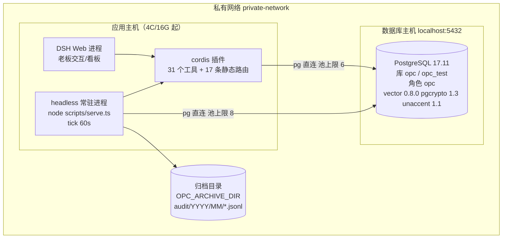

实测环境事实（2026-11-05）：数据库 `PostgreSQL 17.11 (Debian 17.11-0+deb13u1)`，库 `opc`（业务）与 `opc_test`（集成测试）同实例，角色 `opc`；扩展 `vector 0.8.0`、`pgcrypto 1.3`、`unaccent 1.1`；基线迁移链 0001–0003 已应用；0004 Web 层待测试库应用（v2.10）。基线 37 表/272 列，Web 层另增 8 表。PgBouncer 未部署，连接直连 PG。

### 9.2 首次部署与日常启停（已逐条实测）

```bash
cd /path/to/opc-xuanji
set -a; . ./.env; set +a      # 把 .env 载入当前 shell；下文 psql 命令用 $OPC_PG_DSN 与 $OPC_TEST_DSN

# 0) Node 版本基线（要求 ≥ 24.9，实测 24.21.0）
node --version

# 1) 安装依赖 + 准备本地配置（仓库不带口令，只带 .env.example）
npm install
cp .env.example .env        # 然后把两个 DSN 的 CHANGE_ME 换成真实口令
#    缺失 DSN 时启动即报错：缺少 OPC_PG_DSN：请复制 .env.example 为 .env 并填入连接串

# 2) 建库与扩展（DBA 以超级用户执行一次；本项目迁移不创建扩展，-U postgres 会提示口令）
psql -h localhost -U postgres -c "CREATE DATABASE opc OWNER opc;"
psql -h localhost -U postgres -c "CREATE DATABASE opc_test OWNER opc;"
psql -h localhost -U postgres -d opc      -c "CREATE EXTENSION IF NOT EXISTS vector, pgcrypto, unaccent;"
psql -h localhost -U postgres -d opc_test -c "CREATE EXTENSION IF NOT EXISTS vector, pgcrypto, unaccent;"

# 3) 迁移（业务库 / 测试库）
npm run migrate
npm run migrate:test

# 4) 验证：全量测试（61 例，串行防共享库死锁；需测试库）+ 类型检查 + 两道门禁
npm test
npm run typecheck
npm run spec:check
npm run docs:check

# 5) 起独立服务进程（headless 常驻，含 tick）
npm run serve -- --port 3082 --tick 60000
# 另一个终端验证
curl -s http://127.0.0.1:3082/api/v1/health
```

健康检查的实测响应（字段含义：`pg` 连通、`pgvector` 扩展可用、`scheduler.registered/enabled` 为任务数）：

```json
{"code":0,"data":{"status":"ok","version":"0.1.0","pg":true,"pgvector":true,"pgvectorVersion":"0.8.0","scheduler":{"registered":7,"enabled":7}}}
```

| 进程形态 | 启动方式 | 职责 | 注意 |
| :--- | :--- | :--- | :--- |
| 独立服务 | `npm run serve -- --port 3082` | 全量 16 路由 + `seedDefaults` + `setInterval` tick | headless 常驻首选 |
| DSH 插件 | `cordis.patch.yml` 装配后由宿主加载 | 26 个工具 + 15 条**静态**路由（无路径参数） | 带路径参数的动态路由由独立进程提供 |
| 测试 | `npm test` | 单元 25 + 集成 43（Web/员工增量需测试库） | 集成测试只连 `OPC_TEST_DSN`，清 76 张表不清 `_opc_migrations` |

进程退出时：`serve.ts` 监听 `SIGINT`/`SIGTERM`，先 `clearInterval` 再关 server 与连接池；插件 `apply` 在宿主 `dispose` 事件里同样清定时器并 `pool.end()`。

### 9.3 可观测性（轻量，不引 ELK/Prometheus）

| 维度 | 手段 |
| :--- | :--- |
| 存活与依赖 | `GET /api/v1/health`：PG、pgvector、任务数 |
| 调度运行 | `stat.task_run`（status/attempt/error/result）+ `GET /api/v1/tasks` 的 `lastRunStatus` |
| 授权与拒绝 | `audit.audit_log` 中 `result='denied'` 的记录（第 6.4 节有查询） |
| 审计完整性 | `verifyChain()` + 每日导出 sha256 |
| 进程日志 | 池错误 `[opc] pg pool idle error`；tick 失败 `[opc] tick 失败`；路由注册失败 warn |

## 10. 实现边界与偏差登记

### 10.1 Phase 2 清单（接口已定或设计已定，实现未落地）

| # | 能力 | 现状 | 落地位置（预计） |
| :--- | :--- | :--- | :--- |
| 1 | 真实 LLM 裁判调用（Verifier 采样） | `Verifier.judge` 接收调用方给的 `samples`，不自行采样 | `src/workflow/verifier.ts` 增加裁判适配器 |
| 2 | DSH 运行时内嵌定时器 | 插件 `apply` 里 `ctx.setInterval` 分支存在但宿主契约未核对；独立进程 `setInterval` 已验证 | `src/plugin/index.ts` |
| 3 | 业务域模块（其余 9 个） | 仅 `src/domains/project/software.ts` 与 `src/domains/intel/daily.ts` 有局部实现；其余无 `src/domains/*` | `src/domains/{finance,legal,admin,strategy,crm,inventory,vehicle,wbs,publicity}` |
| 4 | `diagnose` 接线 | 诊断逻辑已实现（4 条分流），**未挂到任何 HTTP 路由或工具** | `src/api/http.ts` + `src/plugin/index.ts` |
| 5 | 冲突汇总对外暴露 | `summaryIncludingFrozen` 已实现，**未挂路由/工具** | 同上 |
| 6 | 风险预览对外暴露 | `previewRisk` 已实现，**未挂路由/工具** | 同上 |
| 7 | Registry 只读快照导出 | 产品设计 2.4 要求注册即导出快照，代码未实现 | `src/workflow/registry.ts` |
| 8 | 节点白名单强制 | `completeNode` 未校验 `nodeId ∈ meta.key_nodes`，任意节点名可入库 | `src/workflow/instances.ts` |
| 9 | 测试数据隔离 | `audit_log.test_mode` 列与参数已备，**无调用方传 true** | 三关测试框架 |
| 10 | 流程看板/裁决卡渲染 | 无前端与聚合接口 | 新模块 |
| 11 | 自动固化闭环（生成/三关/影子/观察期/分阶段回滚） | 无 | 设计见产品设计 8.6.9 |
| 12 | 通知投递、CSV/PDF 归档、审计分区 | `stat.notification` 只入队；只实现 JSONL；`audit_log` 未分区 | 见 DBDD 第 6、7 章 |
| 13 | PgBouncer 接入 | 直连 PG | 架构文档 2.4 的池参数已备 |
| 14 | DSH Web 宿主插槽 | `WebHostAdapter` 为封装约定；原生插槽/iframe/降级三档未在真实宿主验证 | `src/web/` + DSH Web 宿主 |
| 15 | 外部检索源 | 插件/关键词雷达支持 config 注入候选；市场/MCP 适配器未接入 | `src/scheduler/tasks/index.ts` + MCP 适配器 |
| 16 | 员工包签名/真实运行时装载 | 包校验/导入导出已实现；签名验签与 DSH 运行时安装/卸载未接入；包内流程文件当前为空 | `src/employees/package.ts` + DSH 插件运行时 |

### 10.2 文档-代码偏差登记（评审逐条确认）

| # | 偏差 | 事实 | 处置 |
| :--- | :--- | :--- | :--- |
| 1 | 模块数 | `modules.yaml` 20 条（v2.10 `web` + v2.11 `wbs`/`publicity`/`employees`）；SRS §13 记 15 个 | 差 5 为装配/Web/新员工/员工包模块；以 `modules.yaml` 20 条为准 |
| 2 | `audit` 模块目录 | 已对齐：审计实现位于 `src/audit/audit.ts`，与 `modules.yaml` 的写域一致（2026-11-05 由集成者调整） | 无需再处置；后续拆分仍需保持写域互斥 |
| 3 | 插件内路由数 | 插件挂 17 条静态路由（基线 8 + Web 7 + 员工 2），其余动态路由由独立进程提供 | 属设计取舍：DSH `webServer.register` 只接受精确路径 |
| 4 | 实例对外标识 | `workflow_instance.instance_uuid` 由库生成，但 `start` 只返回 `instanceId` | 需要 uuid 对外时再补出参（契约变更走 IRS） |
| 5 | `finish` 的状态码 | 重复结束返回 404 `ERR-WF-003`（而非 409） | 与 `WF_NOT_FOUND` 语义一致（"实例不存在或已结束"），保持现状 |
| 6 | 令牌 TTL 常量 | 代码 `MAX_TTL_SECONDS = 300`；产品设计写"≤ 5 分钟" | 两者等价，代码为准 |

## 11. 自检清单

- [x] frontmatter 九字段齐全，`doc_id` 为 `OPC-SDD-001`、`status` 为评审稿、`updated` 为 2026-11-06。
- [x] 四层机制、模块划分与依赖方向有图有表，并附反向依赖自查命令。
- [x] 关键时序（注册→守卫→实例→幂等节点→Verifier→审计）逐段给出审计动作与失败去向。
- [x] 视图级授权（8 视图）、一次性令牌（≤300 秒）、冲突冻结（4 类单元）、审计哈希链（9 段材料）均有 SQL/代码级依据。
- [x] 调度器讲清 cron 5 字段规则、幂等键、force 重跑（+1ms ×3）、tick 推进与失败后不推进的行为。
- [x] 失败与降级分三组列全，未落地的 11 条降级路径标为 Phase 2。
- [x] 环境变量表 5 项 + bundle 配置 6 项 + 连接池参数齐全，附配置自查命令。
- [x] 28 接口、26 工具、13 错误码与源码一一对应，附 `npm run spec:check` 核对方式。
- [x] 部署拓扑写明 PostgreSQL 17.11、pgvector 0.8.0，启动/迁移/测试命令均已实测。
- [x] Phase 2 清单 13 项与偏差登记 6 条逐条写明，未把占位能力写成已实现。

## 12. 与其他文档的关系

| 文档 | 关系 | 差异处理 |
| :--- | :--- | :--- |
| [OPC-SRS-001 软件需求规格说明](OPC-SRS-001-软件需求规格说明.md) | 上游：需求的验收口径 | 本文按其 REQ 编号组织设计与失败路径 |
| [OPC-IRS-001 接口需求规格说明](OPC-IRS-001-接口需求规格说明.md) | 同层：接口契约细节 | 本文只给路由清单与错误码，字段级见 IRS |
| [OPC-DBDD-001 数据库设计说明](OPC-DBDD-001-数据库设计说明.md) | 下游：共享数据层的结构与索引 | 本文第 2、3 层的数据落点由 DBDD 细化 |
| [OPC-STP-001 测试计划](OPC-STP-001-测试计划.md) | 下游：验证本文所述行为的用例 | 61 例与本文第 3、5、6 章的机制一一对应 |
| `OPC-玄机 · 一人公司中枢-产品设计.md`（v2.12） | 上游：业务能力与降级策略来源 | 未落地部分在 10.1 标注，不伪装成已实现 |
| `OPC-玄机 · 技术选型与系统架构.md`（v2.12） | 上游：运行时、数据层、部署基线 | 实测为 PG 17.11；PgBouncer 未启用，见 9.1 |
| [docs/uml/opc-architecture.mmd](uml/opc-architecture.mmd) | 图形视图：组件与 Phase 2 占位 | 图随代码更新，评审看源码 |
| [docs/uml/opc-workflow-sequence.mmd](uml/opc-workflow-sequence.mmd) | 图形视图：注册到评判的完整时序 | 与本文 3.1–3.3、4.1 一致 |
| [docs/uml/opc-class.puml](uml/opc-class.puml) | 图形视图：8 个核心类的方法签名 | 只画真实存在的方法 |
